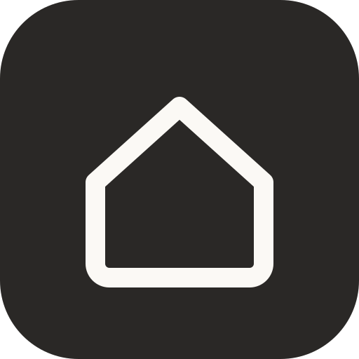
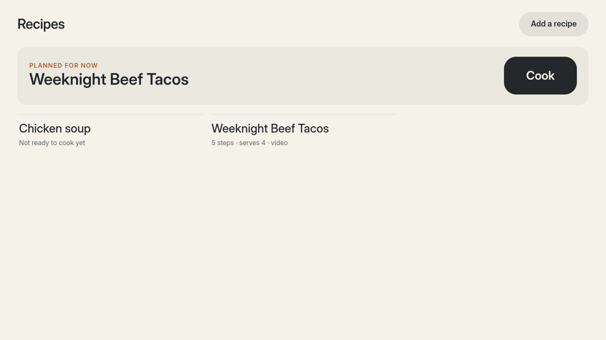
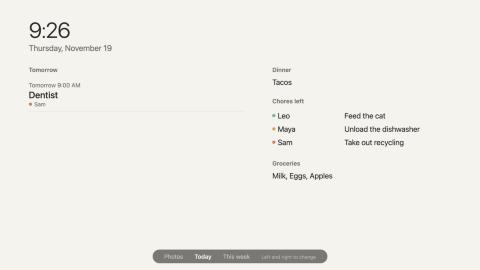

<p align="center">
  
</p>

<h1 align="center">Opie</h1>

<p align="center">
  The screen your household shares, on an Android tablet, photo frame or phone.<br>
  <a href="https://opie.house">opie.house</a> · <a href="https://opie.house/setup">Set it up</a> · <a href="docs/setup.md">Setup guide</a>
</p>

<p align="center">
  
</p>

## Features

- **Calendar:** your Google, iCloud or Outlook calendars on one screen, with each person's events in their color.
  Add events by tapping or by asking.
- **Lists, chores and meals:** the grocery list, who does what this week, and what's for dinner. They're the same on
  the tablet and everyone's phone.
- **Recipes:** save recipes from a link or a photo, then cook step by step, with a timer for the steps that need one.
- **Photos:** a shared album from Google Photos or iCloud, on the home screen and the sleep screen.
- **Weather, map and whiteboard:** the forecast, places you go, and a board the kids can draw on.
- **Voice:** say "Hey Opie" to add to a list, ask what's on tomorrow, or set a timer. The wake word runs on the
  device, so nothing you say leaves it until you say it.
- **Make your own apps:** ask Opie, or your own Claude or ChatGPT, for a chore chart, a countdown or a game, and it
  appears on the screen while you watch. Every app can be changed the same way.
- **Phones and TVs:** everyone's phone gets Today, lists, the calendar and chores, and can send links and photos to
  Opie from the share sheet. A TV can show the day too.
- **Plugins:** add apps others have made, like school lunch menus, trash day or bus times. Each shows what it can
  use, and a grown-up approves it with a PIN.
- **Safe with kids around:** a PIN guards settings, installing apps and leaving the home screen. Opie can't change
  the home screen itself or the parent settings.
- **Sleep screen:** the clock, the weather and the rest of the day, dimmed at night.
- **Backups and away from home:** back up to a USB drive or your own storage bucket, and reach home from away with
  your own Tailscale. Or use Opie Cloud for both.

<table>
  <tr>
    <td></td>
    <td></td>
  </tr>
  <tr>
    <td></td>
    <td></td>
  </tr>
</table>

## Get started

You need an Android tablet, photo frame or phone you can erase, Wi-Fi, and another phone or computer for the setup.
Some devices [work best](docs/tablets.md).

1. Reset the device to its first welcome screen. Remove any Google or Samsung accounts first.
2. Tap the same spot on the welcome screen six times. A code scanner opens.
3. Scan the code on [opie.house/setup](https://opie.house/setup), and accept Android's screens about the device
   being managed.
4. When Opie starts, scan the code it shows with your phone and follow the steps: who lives here, your calendars and
   photos.
5. To talk to Opie, tap **Add a key** on Today and paste an OpenAI key from your phone (OpenAI bills your account, and
   Opie stops for the month at a spending stop you set, $20 to start).

It's free, and nothing in the software is locked behind a subscription. [Opie Cloud](https://opie.house), the
optional hosted service, adds backups, use away from home, and Opie's voice without a key of your own. It's in
private beta.

**No spare Android device?** A Raspberry Pi, a Mac or any Docker host can run Opie, with phones, laptops and a TV as
its screens. See [docs/hub.md](docs/hub.md).

## Documentation

[Setup](docs/setup.md) · [Devices](docs/tablets.md) · [Voice](docs/assistant.md) ·
[Building apps from your computer](docs/workshop-mcp.md) · [Plugins](docs/plugins.md) · [Backups](docs/backups.md) ·
[Networking and away from home](docs/networking.md) · [Opie Cloud](docs/cloud.md) · [Privacy](docs/privacy.md)

## Development

```
Android device (kiosk mode)
├─ shell        the Android app: the home screen's frame, voice, parent settings
└─ Linux runtime (proot)
   ├─ bridge    a Node server: the household's data, the apps, conversations, voice tools
   └─ apps      web pages, one folder each, versioned with git
```

You need a Mac or Linux machine with the Android SDK, and an Android device with USB debugging on (or an emulator).

```bash
scripts/runtime-assets.sh                    # bundle the bridge, the home screen and the starting apps
(cd shell && ./gradlew :app:assembleDebug)
```

- **On a device:** run `scripts/tablet-setup.sh` once over USB (it also installs the voice models, about 390 MB),
  then `ANDROID_SERIAL=<device> scripts/install-display.sh` for each new build.
- **On an emulator:** `scripts/create-avd.sh` once, then `scripts/start-emulator.sh`, and install as above.
- **Tests:** `cd bridge && npm test` and `cd shell && ./gradlew -q :app:testReleaseUnitTest`.

| Folder | What's in it |
|---|---|
| `shell/` | the Android apps |
| `bridge/` | the Node server, the app kit, and the instructions the AIs read |
| `chat/` | the home screen, the sleep screen and the phone page |
| `defaults/apps/`, `plugins/` | the built-in apps and example plugins |
| `connect/` | the connector your computer's AI uses |
| `hub/` | running it on a computer instead of a device |
| `runtime/`, `device/`, `scripts/` | the Linux runtime, its start-up, building and installing |
| `docs/` | design notes, one per part |

## License

[MIT](LICENSE). Bundled third-party code, fonts and models keep their own licenses; see
[docs/third-party.md](docs/third-party.md).
