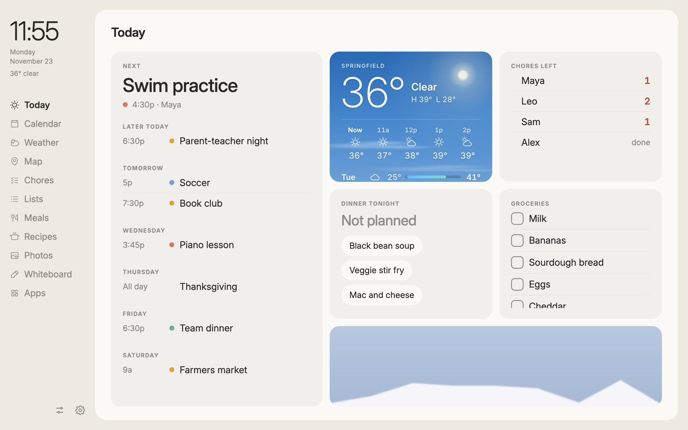

# Opie

Opie turns an Android tablet into the screen your household shares: the calendar, what's for dinner, the
grocery list, chores, photos, the weather. Every tab on it is a small web app, and you can change any of them, or
make new ones, by asking an AI.

There are two ways to talk to it. **Opie**, the voice assistant on the tablet, handles the day-to-day: "add milk",
"what's on tomorrow", "set a timer for the pasta". For building, you connect your own Claude or ChatGPT from a
computer and ask for what you want: "a chore chart for the twins", "a countdown to the beach trip", "show school
lunch on the calendar". It writes the app and you watch it appear on the tablet.



This repo is everything that runs in the home. It's MIT licensed. You set it up on a tablet you buy yourself: the
[tablets we've tested](docs/tablets.md) and [the setup guide](docs/setup.md). The hosted service is at
[opie.house](https://opie.house).

## What's on it

- **Today**, the overview: what's next on the calendar, the weather, dinner, the grocery list, notes from apps
  (like school lunch), a family photo.
- **Calendar, Weather, Map, Chores, Lists, Meals, Recipes, Photos, Whiteboard**, each its own app, plus an Apps
  grid for everything else. Which tabs show and in what order is up to you.
- **A sleep screen** with the clock, the weather and the rest of the day, dimmed at night.
- **Phones and other screens.** Each person's phone gets a page with Today, lists and the calendar, and can send
  things to Opie from the share sheet. A TV can show a simple version of the home screen.

## Plugins

Every app is a plugin: the built-in ones, the ones a household makes, and ones shared from a link. A plugin is a
folder of web pages plus an `app.json` that says what it's allowed to use: which household data, which websites,
which voice actions.

Installing one from someone else shows a card listing exactly what it gets, and a parent approves it with a PIN.
Plugins from a link run in their own browser origin and can't reach a website they weren't approved for. Settings
has a gallery of plugins we've reviewed.

[`plugins/`](plugins) has working examples: school lunch menus, trash day, bus times, a reading log, a pantry list,
a bedtime routine and more. [docs/plugins.md](docs/plugins.md) is the full reference, and
[bridge/AGENT.md](bridge/AGENT.md) is the guide an AI reads when it builds an app here.

## Kids are around

The tablet sits in a shared space, so some things are deliberately out of the AI's reach:

- The home screen itself, the parent settings and the watchdog that restarts things are fixed. AI can change the
  household's apps, not those.
- Opie works through a fixed set of household tools (lists, calendar, chores, notes, tabs). Asked for a new game or
  a small tab, it can make one on the tablet, but a grown-up's PIN is needed before it goes in
  ([building-on-the-tablet.md](docs/building-on-the-tablet.md)). Bigger changes come from a computer someone has paired.
- A PIN guards settings, turning on the assistant, pairing a computer, installing apps and leaving kiosk mode.
- The wake word ("Hey Opie") runs on the tablet. Nothing you say goes anywhere until someone says it.

## How it works

```
Android tablet (kiosk mode)
├─ shell        the Android app: the home screen's frame, voice, parent settings
└─ Linux runtime (proot)
   ├─ bridge    a Node server: the household's data, the apps, conversations, voice tools
   └─ apps      web pages, one folder each, versioned with git

Opie cloud (optional)   live voice, accounts, backups, updates, reaching home from away
Your computer                Claude or ChatGPT, connected through the Opie connector
```

Apps get a small JavaScript kit for the household's data, the calendar, Today, voice actions and devices on the home
network. Every change to an app is a git commit with who asked for it.

Voice: the wake word is a small model of our own ([docs/wake-word.md](docs/wake-word.md)), built on
[openWakeWord](https://github.com/dscripka/openWakeWord)'s features. After it wakes, the conversation is OpenAI's live
voice, through the household's Opie account ([docs/assistant.md](docs/assistant.md)).

The cloud isn't in this repo. Without it, the tablet still runs on your home network: the home screen, the apps,
plugins, backups to a USB drive, and building from a computer. [docs/cloud.md](docs/cloud.md) says what the tablet
sends it and what it keeps.

## Building it

You need a Mac or Linux machine with the Android SDK, and an Android tablet with USB debugging on (or an emulator).

```bash
scripts/runtime-assets.sh                    # bundle the bridge, the home screen and the starting apps
(cd shell && ./gradlew :app:assembleDebug)
```

- **On a tablet:** run `scripts/tablet-setup.sh` once over USB. It also installs the voice models (about 390 MB).
  After that, `ANDROID_SERIAL=<device> scripts/install-display.sh` installs each new build.
- **On an emulator:** `scripts/create-avd.sh` once, then `scripts/start-emulator.sh`, and install as above. For
  voice, `scripts/voice-models.sh <folder>` and `scripts/voice-install.sh <folder>`.
- **Without a tablet:** a Raspberry Pi, a NUC, a Mac or any Docker host can run it, with phones, laptops and the
  TV as its screens. See [docs/hub.md](docs/hub.md).
- **Tests:** `cd bridge && npm test` and `cd shell && ./gradlew -q :app:testReleaseUnitTest`. The home screen page
  builds with `cd chat && npm ci && npm run build`.

Then on the tablet: Settings → Cloud links an account, Settings → Live voice turns on Opie, and Settings → Screens and
computers pairs a computer for building ([docs/workshop-mcp.md](docs/workshop-mcp.md)).

## Where things are

| Folder | What's in it |
|---|---|
| `shell/` | the Android apps |
| `bridge/` | the Node server (no dependencies), the app kit, and the instructions the AIs read |
| `chat/` | the home screen, the sleep screen and the phone page |
| `defaults/apps/` | the built-in apps |
| `plugins/` | example plugins |
| `connect/` | the connector your computer's AI uses |
| `hub/` | running it on a computer instead of a tablet |
| `runtime/`, `device/`, `scripts/` | the Linux runtime, its start-up, building and installing |
| `docs/` | design notes, one per part. Many are dated working notes; the code is the source of truth |

## License

[MIT](LICENSE). Bundled third-party code, fonts and models keep their own licenses; see
[docs/third-party.md](docs/third-party.md).
