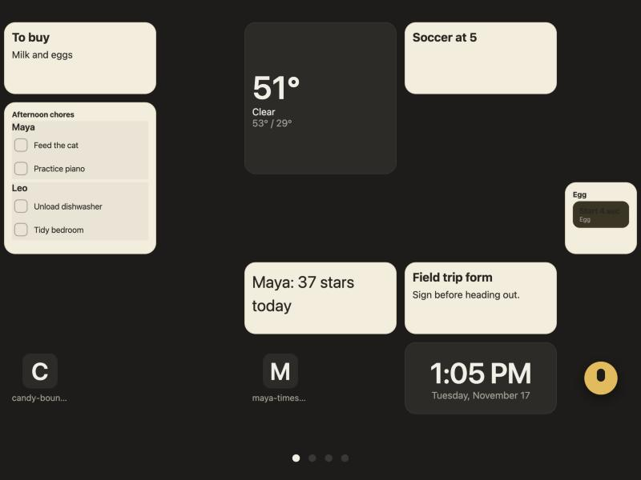

# Brain, screens and the workshop

Steps 1–3 and the move to web only (step 6) are built on this branch (see "Built so far" and "Web only" below).
The rest is a plan. It splits openhouse three ways: a **brain** that keeps the house's data, **screens** that draw
the door, and a **workshop**, the family's own laptop, where apps get made and changed. A single tablet keeps working
as it does today, as its own brain and screen.

The starting idea was to split the brain from the screens. Two points from the discussion reshaped it:

- Customizing belongs on the laptop. Whoever has a ChatGPT or Claude plan already has Codex, Claude Code or
  something like it there.
- We shouldn't write our own agent harness. Customizing should be a plugin, skill or MCP server for whatever agent
  people already run locally.

## Built so far (steps 1–3)

- **Door as data.**
  - Timers are in door.json (`POST /door/timer`, `timers` in `GET /door`). The shell mirrors them both ways and
    still rings them (`MainActivity.mirrorTimers`, `Timers.onStart/onStop`).
  - `GET /apps` relays the build server's list.
- **Screens on the home network** (`bridge/screens.js`).
  - Off until "Add a screen". Port 8788.
  - Pairing: a QR code, then a sealed hello, then the brain asks, then a sealed welcome with the screen's own key.
  - Every request after that is sealed.
  - Scopes are an allowlist.
  - Revoking ends a screen's open requests at once.
  - Requests reach the same routes the display uses (`route()` in `server.js`); there is no second copy.
- **Settings → Screens** (`shell/Screens.kt`): the list with last seen, Remove, Add a screen (QR, link, Share),
  the Allow/No prompt, and Home network on/off.
- **Browser screen** (`chat/src/screen.jsx`, served at `/screen/`). It:
  - draws the door's pages live: notes, clock, weather, the starting widgets, app icons, timers;
  - drags on `grid.js`'s rules, and a long press steps a note or widget to its next shape;
  - ticks lists and chores;
  - rings timers with Web Audio;
  - takes a typed question and streams the answer.

  Its client (`chat/src/screen-client.js`) and cipher (`chat/src/seal.js`) are the same code the bridge tests run.
- **Tests.** `bridge/test/screens.test.mjs` (11 tests) covers:
  - pairing (yes, no, one use, wrong keys);
  - the door both ways, timers, a typed question;
  - every refused route;
  - nothing unsealed on the network, replays, another screen's key;
  - revoking mid-request;
  - the home network off and on.

  `npm test`: 50 pass.

### Checked between an emulator brain and a desktop browser
On my own emulator (`display-screens`, a clone of display-grid), with the APK built twice as usual:
1. Settings → Screens → Add a screen showed the QR code. The browser joined, and Allow on the emulator let it in.
2. Both doors showed the same notes, widgets and places.
3. Moving the clock on the browser moved it on the emulator. Dragging a note on the emulator moved it on the browser.
4. A typed question from the browser was answered by the brain's assistant (Codex, already signed in on that
   emulator).
5. A note's timer started on the browser rang on the emulator. Stopping it there removed it from the browser.
6. A timer started on the emulator itself was mirrored once and cleared when stopped.
7. Remove in Settings: the browser showed "This screen was removed" within seconds.
8. Home network off closed the port.

### Known gaps
- On a screen, buttons inside a small note or widget work, but dragging has to start on the paper, not on a button.
- Family apps open only on the display, not on other screens yet. The dev server listens on the tablet only; serving
  apps to paired screens is a next step.
- **Testing tip.** Chrome's connections through `adb emu redir` were reset mid-load. `adb forward tcp:<mac>:8788`
  works, because the listener binds all addresses.
- **The agent can still reach the pairing routes and the app keys.** While the coding agent runs on the device as the
  bridge's user, it could call the loopback `/screens` and `/apps/key` routes. The workshop plan removes the agent
  from the device.

## Web only (step 6)
Nobody uses openhouse yet, so native family apps are gone rather than kept alongside.
- **The tablet's door is the door page.** `shell/DoorView.kt` shows the bridge's `/screen/?display` in a web view:
  the same page other screens show, from the same data.
  - On the display it talks to the bridge with the display's secret and places anything new (an app, a timer).
  - Only the shell can do a few things, and the page asks for them through `window.OpenhouseDisplay`: open an app,
    the settings, the weather sheet, a video, and whether the display is idle (the photos screensaver).
  - The shell's overlay (the assistant's note, listening, typing, conversations, settings) is still native and sits
    above it, and the shell still rings the timers.
  - The Compose door (`ui/Board.kt`, `DoorGestures.kt`, `Widgets.kt` and the rest) is removed.
- **Family apps are web pages.** Each one lives in `webapp/apps/<id>/` (`index.html`, `main.js`, `app.json`,
  `icon.svg`).
  - Vite serves it and reloads it on every save (`device/vite.config.mjs`, kept outside the apps folder).
  - Each app opens in its own installed Android app, as before (`AppStubs`, `AppWindow`), now in a web view
    (`WebApps.kt`).
  - An app reaches the family's data only through the kit (`bridge/kit/openhouse.js`), with its own key from the
    bridge (`bridge/apps.js`).
  - That key opens the house's data, the door, timers and speaking. It never opens undo, deleting apps, the builder,
    devices, the agents' tools, the household's settings or screens.
  - The kit's `phone.photos()` and `phone.list()` ask the app's window for the QR phone pages.
- **The starting apps** (Calendar, Chores, Lists, Meals, Photos) are rewritten as web apps in `defaults/apps/`.
- **The door's look** is `apps/home/style.json` (`{door, clock}`), which the agent edits like an app.
  - Things the family wants to glance at are notes or an app's widget.
  - There's no family "home board" code any more, so the home app's own `own:` things are gone.
- **Removed:** the Kotlin build server, its jars and JRE (in the Dockerfile; the existing runtime image still carries
  them until it's rebuilt), `compose-libs.sh`, `HotSwap.kt`, `NativeHome.kt`, the host app's old dex activity, and
  every native section of `AGENT.md`, which now describes web apps and the kit.
- **Tests:** `bridge/test/apps.test.mjs` covers:
  - the list;
  - keys only for the display;
  - what an app's key opens and doesn't;
  - wrong and borrowed keys;
  - the kit and the door page needing no key, but only on this device's own address.

## The family's own apps, moved to web
The tablet's own family-made apps were native too. They're rewritten as web apps in `defaults/ports/` (see its
README).
- **When a port applies.** `start.sh` swaps one in only when the device's `apps/<id>/App.kt` is exactly the source it
  was ported from (`replaces.sha256`), so it never touches anyone else's app, nor one the family changed since.
- **What's ported:**
  - **Drawing:** pen pressure, palm rejection, the eraser end, all six tools and the palettes; saving an image puts
    it in the family's Photos.
  - **Typing Garden:** the learners are the family, from the house, with no names in the code.
  - **Their door:** landscape photos behind it and their compact clock, as `apps/home/style.json`. Their
    `Weather.kt` card was never on their door (their `App.kt` didn't use it), so its look is there as an option
    (`"weather": "family"`) but isn't switched on.
- **Pocket Pet** (Cuddle Club) was already a web app. It needs no change: it keeps its own `localStorage`, in its
  same window.
- **Saved things.**
  - Apps now have their own storage in the bridge (the kit's `store`; `/appdata`, only with that app's key). It
    survives an app's window being reinstalled and reaches other screens.
  - What an old native app saved lives in its own Android package, where adb can't read it. The app's window now
    runs the shell's code inside that package, so the first time it opens after the update it sends those files and
    preferences to the bridge, once (`AppWindow.handOver`).
  - The web app takes them in with `store.legacy()`. The old files stay where they were.
- **The gallery's drawings.** The old Drawing app saved images to the gallery (`Pictures/Drawings/Drawing-*.png`).
  - The shell copies them into the family's Photos once (`GalleryDrawings.kt`). It's a copy, never a move or a
    delete.
  - To copy, the shell (device owner) grants itself gallery read access. The grant stays, because revoking it makes
    Android stop the display's process; it's set back to the default state rather than locked on.
  - The web Drawing app lists them with its own saves and opens them as a picture to draw on.
- **Nothing that may hold saved work is removed.**
  - The shell no longer uninstalls an app's window on its own: not for a deleted app, which is only shut out of
    kiosk mode, and not for one signed by an older key, which then opens in the display instead.
  - An app that's still only Kotlin is listed with `web: false`. It's left off the door, but its window stays.

## Three roles

| Role | Runs on | Does |
|---|---|---|
| Brain | one full tablet (today's Tab S10 FE) | the door and the house's data, voice, short answers out loud, kiosk, undo, the watchdog |
| Screen | the brain's own display, an old tablet, an iPad, a frame with a browser | draws the door, moves things, ticks lists, types a question |
| Workshop | the family's laptop | makes and changes apps and the door's look, with the family's own agent and an openhouse MCP server |

## What runs on the device

### Before this branch
Everything runs in the shell's uid. A proot Ubuntu holds Node, a JRE and git. Inside it are:
- the bridge;
- the agent CLI (Claude Code with Bash, Edit and Write, or Codex with no sandbox);
- the Kotlin build server;
- Vite.

The agent can rewrite the bridge and its start script, and it can read the bridge's secret
(see the isolation review, items 3 and 4, parked).

### Proposed

| Piece | Stays on the device? | Why |
|---|---|---|
| Shell: kiosk, PIN, watchdog, undo, timers ringing | yes | unchanged; nothing the agent can edit |
| House server: door, grid, lists, chores, meals, photos, calendar, weather, timers, screen pairing | yes | plain data, no AI. The door works when the AI service is down or nobody is signed in. |
| Voice: wake word, speech-to-text, voiceprints, on-device speech | yes | the microphone never leaves the house |
| Ask path: a question at the wall gets an answer, a note or a timer | yes, thin | one vendor-CLI call with only the door and house MCP tools: no Bash, no file reads or edits, no install |
| Coding agent, edit lock, builder | no, it moves to the workshop | the agent stops being on the household device at all |
| Kotlin build server and JRE | no, if apps become web apps (see the decision below) | the largest part of the runtime image after the CLIs |
| Running family apps | yes | a web view (web apps) or today's stub APKs (native) |

What this buys:
- **Isolation by design.** Parked items 3 and 4 mostly stop mattering. The thing that edits code runs on the
  laptop, and the ask path on the device has no write tools.
- **Less to run.** No JRE or compiler, maybe no Vite. A cheaper tablet might be enough for a brain, but that's
  untested: nobody has measured RAM without these pieces.
- **Less to maintain.** No edit lock, no builder, and no agent plumbing beyond the ask path.

What stays hard:
- **The ask path still needs the vendor CLI on the device.** Claude Code needs Node, so some Linux userland stays:
  proot, or a Node built for Android. Codex ships a static Linux binary that might run without proot. Neither has been
  tried.
- **Kids can't say "make me a game" at the wall any more.** That's the main product cost (see the decisions below).

## Step 1: the door as data

Notes, the grid, pages, places, the trash and widget layouts are already bridge data (`door.js` `view()`,
`grid.js`). House data (`/house`), the board (`/board`) and the weather (`/weather`) are too. Gaps a second screen
would hit:

1. **Timers live only in the shell** (`shell/Timers.kt`). The bridge knows a `timer:<endAt>` key only as a place on
   the grid.
   - Fix: the bridge keeps `{label, total, endAt}` in door.json, with `POST /door/timer {start | cancel}`, and
     `view()` includes them.
   - The shell mirrors them and still does the ringing.
   - Reconciling: start what the bridge lists, stop what it dropped, never restart one stopped locally.
2. **The apps list comes from the build server** (`:8790/apps`), which a screen can't reach.
   - Fix: the bridge relays `GET /apps`. Icons are already small SVGs a browser can draw.
   - In the workshop design, the apps list comes from the brain's apps repo anyway.
3. **Widgets and notes are drawn natively** (`Widgets.kt`, `AnswerView`).
   - The data is all in the bridge. A browser screen needs its own drawing:
     - the json-render React renderer in `chat/src` already draws notes and agent widgets;
     - the five starting widgets need HTML versions.
4. **The clock** is local, and each screen draws its own.

Nothing else on the door comes from the shell process.

## Step 2: the bridge on the home network, behind pairing

- **Listener.** An opt-in second listener (port 8788) on the home network, turned on from the PIN-protected parent
  menu ("Add a screen" turns it on; a switch turns it off). The loopback listener and its `X-Openhouse-Token` stay
  as they are.
- **What the LAN listener answers.**
  - Without a key: the screen page's static files, plus two pairing routes. Nothing else.
  - Everything else is one sealed route.
- **Pairing**, reusing the phone page's ideas (`Handoff.kt`):
  1. Settings shows a QR code: `http://<brain>:8788/screen/#<pairing id>.<one-time key>`. The key is after
     `#`, so the browser never sends it. It lasts 10 minutes. The same link is shown as text for a device that can't
     scan.
  2. The screen sends a hello sealed with the one-time key, giving a name for itself.
  3. The brain asks on its own display: a screen wants to join, Allow or No.
  4. On Allow, the brain sends the screen its own 32-byte key, a screen id and its scopes, sealed with the one-time
     key. The one-time key is then dead.
- **Sealing.** Plain http has no WebCrypto, so the page carries the same ChaCha20-Poly1305 as the phone page
  (`chat/src/seal.js`). The bridge uses Node's.
  - Each request is `{counter, method, path, body}`, sealed with the screen's key and labelled with its id.
  - The counter is microseconds of the screen's own clock. The brain accepts a counter above the highest one from
    before its last restart, not seen before, and within a minute of the newest. So a replayed request is refused,
    and requests that arrive out of order still work.
  - Replies come back as sealed frames, labelled with the request and the frame number, ending in an end frame. So
    streamed answers and the door's long poll work, and a cut-off reply is noticed.
  - The bridge checks the scope, then hands the opened request to the same routes the loopback listener uses. There
    is no second copy of any route.
- **Scopes** are an allowlist; anything not listed is refused:
  - `door`: read the door, house data, photos, weather, apps, state;
  - `arrange`: move, resize, trash, put back, timers, ticking lists and chores;
  - `ask`: a typed question, stopping it, reading that conversation;
  - `voice`: reserved. A screen's microphone isn't routed in the first version.
  - Never allowed: undo, restore, deleting apps, the builder, `/door/mcp`, devices, `/mcp/home`, the household,
    voice enrollment, calendars, or the screen routes themselves.
- **Revoking.** Settings lists screens (name, when added, last seen) and removes them. A removed screen's
  open streams close at once and its next request is refused. The page then forgets its key and shows the pairing
  screen.
- **Known limits.**
  - On plain http, someone actively attacking the Wi-Fi can change the page's JavaScript before it runs (the same as
    the phone page). Someone only listening sees sealed bytes.
  - While an agent with Bash still runs on the device as the bridge's user, it could call the loopback pairing
    routes itself. Moving the agent to the workshop closes that.

## Step 3: the second screen is a browser page

Recommended over the Android shell in screen mode:
- It works on any old tablet, iPad, laptop or frame with a browser, with nothing to install. That suits the tiers
  the hardware review recommended: cheap frames and old tablets only as screens.
- The pieces exist already: the React json-render renderer in `chat/src`, the phone page's sealing, the bridge's
  long poll.
- It's what a web-app future needs anyway (see the decision below).
- Screen mode for the shell would mean a second kiosk setup on every screen, and it only covers Android.

What the page does:
- draws the door's pages from `/door`, following `/door/wait`;
- moves and resizes on the same grid rules (`grid.js` is plain JS and can be shared as is);
- ticks lists and shows timers (ringing with Web Audio);
- takes a typed question and streams the answer.

Native family apps show as icons that can't open on a browser screen until the decision below is made.

## The workshop: customizing from the laptop

There's no harness of our own. We ship two things for whatever agent the family already uses:

- **An openhouse MCP server**, a small local program the agent starts. It pairs with the brain the way a screen
  does, with a `workshop` scope that screens never get:
  - read the door and the household's apps;
  - pull an app's source and push a change: committed to the apps repo on the brain with who asked and what for, so
    undo, last-good and the watchdog keep working as today;
  - see build or load errors and a screenshot of the app running on the brain;
  - set an app's widget and arrange the door.
- **A skill / AGENTS.md** with how openhouse apps are made (what AGENT.md says today): Claude Code takes it as a
  plugin, Codex and others as an AGENTS.md plus the MCP config.

Pushes to the brain get the same checks someone would want. Each push is a commit undo can take back, the watchdog
restores last-good if the screen fails to load, and the shell never loads code it hasn't checked.

## Decisions for you

### 1. Family apps: web apps on any screen, or native Compose on full tablets only?

| | Web apps (HTML/JS, served by the brain) | Native Compose apps (today) |
|---|---|---|
| Runs on | every screen: the brain, old tablets, iPads, frames, the laptop while making it | full Android tablets running the shell only |
| Building | none; the agent writes files and the browser loads them | Kotlin to dex: the build server and JRE stay on the brain, or every laptop needs Android build tools |
| Preview while making it | the laptop's own browser, instantly | the brain's screen, or an emulator on the laptop |
| Agents' skill at it | very high; it's what they write most | good, but slower to iterate, and compile errors cost turns |
| Feel on the wall | good in a WebView; less native gesture feel | best: same widgets and gestures as the door |
| Device access (camera, mic, sensors, other apps) | through a small bridge API the shell offers the WebView | direct |
| Safety | a WebView sandbox per app, only bridge routes it's allowed; easy to limit | runs Kotlin code in a stub APK's process; needs the dex checks from the isolation review |
| Cost to switch | rewrite the 5 starting apps' screens in HTML (their data is already in the bridge); a WebView host in the stubs; port family-made apps or keep them native-only | none now; screens other than full tablets show icons only |

**Decided (2026-11-17): web apps.** Everything new is a web app. Existing native apps keep running on the brain
until they're rewritten. What this means:
- **The shell gives deeper access.** On the brain, the shell's WebView offers a small JS API for what the browser
  can't do on its own: speech, the house's live state (who's talking, timers, the answer), opening apps, and
  device features behind the usual parent approval.
- **Each app gets only what it's allowed.** An app gets only the parts of that API it's allowed, so deeper access
  doesn't mean more risk.
- **Remote screens use the plain browser.** They show and touch but don't listen.
  - The microphone, camera and offline caching need a secure context, which plain http on the home network isn't.
  - Apps that need the mic or camera run on the brain only.
  - If a listening second screen matters later, the options are real HTTPS per house (a hostname and certificate
    pointing at the brain's local address) or the shell in screen mode on old Android tablets.
- **Previews anywhere.** An app being made can be tried on the laptop, a phone or any paired screen before it goes on
  the door. The workshop can show a draft there while the door keeps the last version.
- **One kit for every screen.** A web version of the openhouse kit (colors, paper, notes, fonts) and the live-state
  API are built once and shared by the browser screen and every family app.

### 2. Making things at the wall

With the coding agent on the laptop, "make me a game" said at the wall can't build anything right away. Options:
- **(a)** The wall says it'll ask someone, and the request waits in the workshop's list for the laptop's agent to
  pick up.
- **(b)** Keep a small on-device path for little changes ("make the stars bigger") with tight tools, only to apps.
- **(c)** Drop it.

(a) keeps the agent off the device. (b) keeps some of today's magic but brings back the isolation problem in a
smaller form.

### 3. Where the ask path runs

On the brain, as above. Or, while the laptop is awake, on the laptop, with the brain falling back to its own. Keeping
it on the brain is simpler and works when the laptop is shut.

## Order of work

1. Step 1 gaps: timers into the bridge, the `/apps` relay. The single tablet is unchanged apart from timers being
   mirrored.
2. Step 2: the LAN listener, pairing, scopes, revoking, with bridge tests. Then Settings' Screens items.
3. Step 3: the browser screen, checked between an emulator brain and a desktop browser.
4. The workshop MCP server and skill, reusing step 2's pairing. Move undo and last-good checks to cover pushes.
5. Take the coding agent, builder and edit lock off the device. Trim the ask path's tools. Re-measure RAM.
6. Web apps (decision 1): done on this branch (see "Web only").

After every step, the single-tablet path is checked on an emulator: `scripts/runtime-assets.sh`, then gradle.
