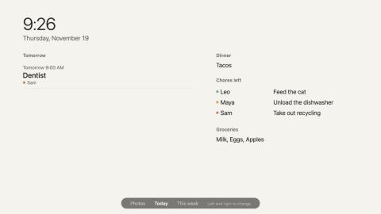
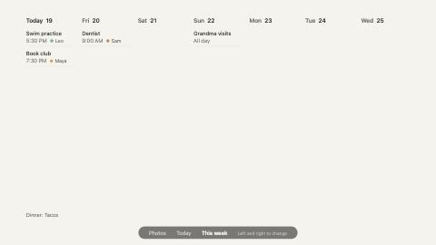
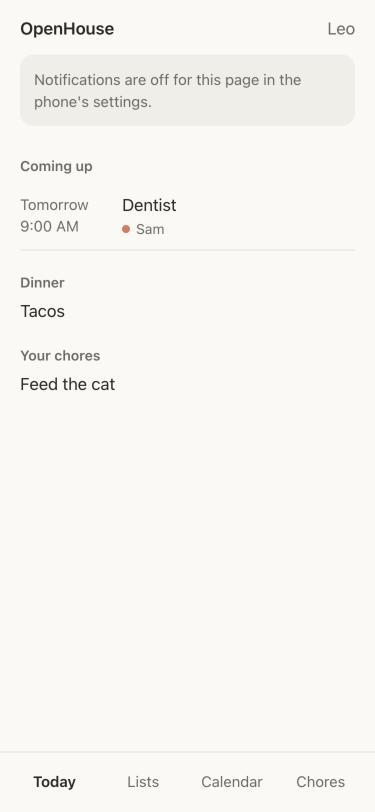
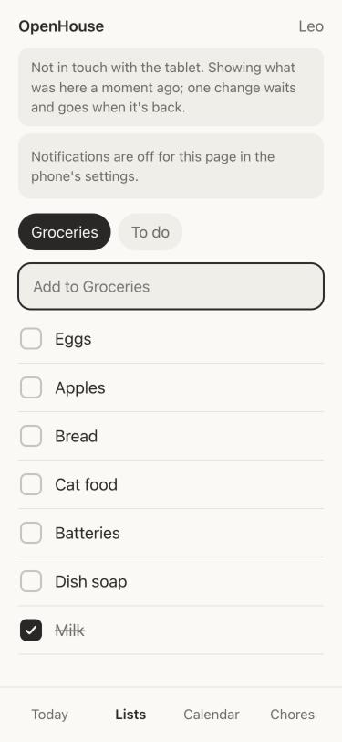

# Phones and TVs

2026-11-19. How the tablet works with the household's phones and TVs. The first
versions of three pieces are built (below). Google Cast and the cloud's https copy of the phone page are not.

## Built so far (prototypes, not on a tablet yet)

**Devices ask first.** The assistant's first change to a device asks the people here once ("Let the assistant control
the Living room TV?"), and the yes is kept with the device. Reading a device never asks; turning it on or opening an
app still asks every time. A device's own certificate is kept for its address, and a different one there is refused
(pairing it again forgets it).

**The TV by voice.** The live voice (and the cloud assistant) get a `tv` tool whenever the tablet knows a TV it can
control: off, on, pause, play, volume, mute, open an app, what's on. It maps to whichever driver the TV has (Roku,
Samsung, and a new LG webOS driver, `bridge/devices/drivers/lg.js`), with no agent turn. Turning on and opening an
app still ask the room. Tested against a fake LG TV (`bridge/test/tv.test.mjs`); no real TV touched.

**The home screen on a TV** (the app `tv`, `defaults/apps/tv`, plugin `openhouse-tv`). The TV's browser opens `<tablet>:8788/tv` and shows a code; someone
 types it on the tablet (Screens > Add a screen > A TV, with the TV's name). Typing it there is the yes, so the
TV joins at once with only the `door` scope: it shows and can't change anything. Both sides turn the code into the
pairing (`chat/src/scrypt.js`, the same scrypt as computers' codes, in plain JS because a TV's browser on http has no
WebCrypto). Three views, left and right on the remote: the photos (time, caption, what's next), Today, and the week.
After 10 minutes untouched it goes back to the photos; in the household's night hours it shows only the time and the
first thing tomorrow, dim, until a key is pressed.

 

**The TV's layout is a plugin** (read only, for now). An app whose `app.json` says `"screens": ["tv"]` is what a paired
TV shows; the tablet doesn't list it. Ours is `tv`, so the household changes it like any app ("bigger photos, no week
view" is an edit to it, and "put ours back" and undo work the same), or makes its own, which the TV shows instead.
How it runs (`bridge/screens.js`, `TvFrame` in `chat/src/screen.jsx`):
- The TV asks `GET /screens/apps` (sealed, `door` scope) for its apps: the household's own first, each with an address
  `/screen-app/<id>/<token>/` whose token comes from that TV's key, and a version, so an edit reloads it on the TV.
- The app's files come from that address on the home network into a **sandboxed frame** with no origin of its own: it
  can't reach the TV's key, and its CSP lets it fetch nothing (`connect-src 'none'`). `app.json` isn't served.
- The kit (`/kit/openhouse.js`) sees it's in a screen's frame (`#screen=1`) and asks the page around it instead of
  fetching. The page only passes on GETs, sealed and marked with the app (`{a: id}`); the tablet answers only GETs
  for an app this TV shows, and only what that app may read (`appAllowed`, `houseFor`, as on the tablet). So a TV
  layout from a link would see only what its card granted. The remote's keys reach the app either way.
- Plain files only (no packages: the TV doesn't get the tablet's dev server), sized in `vh`.

Later: phones' apps (they change things, so a phone's person has to reach the plugin), changes from a TV, picking
which of several TV apps a TV shows (now: the household's own first), and shared TV layouts from links (possible
now; nothing needs them yet).

**Someone's phone** (`chat/src/phone.jsx`, served at `<tablet>:8788/phone/`). Screens > Add a screen > Someone's
phone > the person > whether it can ask Opie gives a QR code; the phone joins after Allow. Someone's phone gets `door`,
`arrange`, `ask` and `notify`; a kid's the same without `ask`. Tabs: Today (notes for them, what's coming up,
dinner, their chores), Lists, Calendar (two weeks), Chores. The last copy is kept on the phone, and ticks and new
items made with no signal wait there and go when it's back in touch. Notes put up "for" someone go to their phones by
Web Push, sent by the tablet itself (`bridge/web-push.js`: RFC 8291 encryption, checked against the RFC's own
example, and VAPID; only Apple's, Google's, Mozilla's and Microsoft's push hosts are accepted as addresses). A phone
that unsubscribed is forgotten.

Opie can message someone's phones, or everyone's ("tell Alex dinner's ready", "let everyone know we're leaving in
10 minutes"): `message_family` in `bridge/live-tools.js`, to a name from the household's family list or everyone. It
goes by the same Web Push ("From the tablet", or "From Sam" when Sam asked from her phone, then the words as said),
and answers who got it and who has no phone paired or notifications off. Their phone's Today shows it for half a day
(`GET /phone/messages`, the `notify` scope; kept a day in the tablet's memory, never written down).

 

Tried in a browser against a local bridge: the phone paired as Leo's, ticked and added items that reached the tablet,
and with the tablet's home network switched off an added item waited on the phone and arrived when it came back on.

**The phone page from the cloud** (`/h/`, `openhouse-cloud/scripts/phone-app.ts` makes `openhouse-cloud/lambda/phone-app.ts` from the
phone page). Once the household reaches the tablet from away, the phone page on the Wi-Fi offers "Open the app
version": the same page from the cloud over https, with the phone's pairing after `#` (the service never sees it). It
talks to the tablet only through the relay, can be added to the home screen, and has its own service worker for
working offline and showing notes. Tried with the local cloud service: the page loaded the household and an item
added there reached the tablet through the relay; Screens showed the phone "from away". It's a different page from
the household's photo page at `/p/` (another session's); one app on the phone with photo sharing as a tab is the
obvious next step.

**Not done yet:**
- **Notifications and installing on a real phone.** Untested: it needs the cloud deployed. The
  in-app browser here runs no service workers at all (the `/p/` page's fails the same way).
- **Adding events and asking Opie from the phone.** Phones tick and add to lists and chores. Events need a new
  scope; a typed question works through `ask` but has no screen on the phone yet.
- **Google Cast and the Android TV remote.** Need a real Chromecast or Google TV (and the Cast developer registration).
- **An installed TV app** (Tizen, webOS developer mode). Not built: installing means touching a real TV.
- **Old TV browsers.** The page targets Chrome 110 / Safari 15; older Tizen and webOS browsers may not run it.

## Ideas from Lamp (read 2026-11-19)

Lamp's own skills and builds (phone-pages, phone-controllers, device-control, wish-links, its Home HQ screen) cover
the same ground. Its TV design skill isn't one to follow (its origin is unclear). What's worth taking:

- **Let the tablet do the typing, not the remote.** Built: the TV shows a code and the tablet types it.
- **An installed TV app instead of the TV's browser.** Lamp packages the same web page as a Samsung (Tizen) or LG
  (webOS) app through the TV's developer mode, with the remote's media keys and Back that leaves the app. No
  address to type. Developer mode trusts one computer's address, so on a household's TV it's an enthusiast's step.
- **Samsung The Frame's art mode** could show the household's photos as art with no app. Not to be built.
- **Day, ambient and night.** Built on the TV page (photos when untouched, a dim clock at night). Home HQ also gives
  photos a line like "3 years ago today"; our photos have no dates yet.
- **Ask before the first change to a real device**, then remember the answer per device. Built.
- **A device's own certificate is trusted for its address only.** Built.
- **Status in words for each device** ("Open the TV app on your TV", "last seen 5 min ago"), as Lamp's peers have.

---

## Phones

### What a household member wants on their phone

In order of how often it's used:

1. **The lists at the shop.** Live, ticking and adding, and still working with no signal. Exists today as a 3-hour
   QR page. The gap is that people have to scan again every trip.
2. **What's on today and this week.** The calendar, with everyone's events.
3. **A note from the tablet for them.** "Dentist at 4, Sam", "the milk is on the list twice", a heartbeat note
   ([heartbeat.md](heartbeat.md)). This means push notifications.
4. **Adding things from anywhere.** To a list, an event, a chore done. Also a photo for Photos, or a school flyer
   to Opie.
5. **Chores and stars.** For a kid with a phone: theirs for today, ticked off.
6. **Talking to Opie.** Typing works through the `ask` scope already. Voice is later (see below).

What doesn't belong on the phone: settings, Settings, making apps (that's the workshop, on a computer).

### The shape: a web app from the cloud, installable (recommended)

| | Web app from the tablet (http) | **Web app from the cloud (https), through the relay** | Native iOS/Android apps |
|---|---|---|---|
| Install to home screen | No (needs https) | Yes | Yes |
| Push notifications | No | Yes: Web Push (iOS 16.4+, once it's on the home screen) | Yes |
| Offline lists | While the tab stays open | Yes (a service worker, and the last data kept on the phone) | Yes |
| Works away from home | Only if opened at home first | Yes | Yes (needs the relay too) |
| Needs the cloud | No | Linked tablet and Use it away from home on | The relay, plus app-store accounts |
| Microphone (voice to Opie) | No | Yes | Yes |
| What we ship | Nothing new | One page on the cloud, as with `/l` | Two apps, store reviews, updates |
| Effort | Small | Medium (about 1–2 weeks) | Large (months), plus app-store accounts |

**Recommendation: the cloud web app.** It's the list page, made into a whole app. Same sealing, same relay, same way of serving
it from the cloud. A household without the cloud still gets today's QR pages and can pair the screen page on a phone
over the Wi-Fi. Native apps are worth it later only for things the web can't do well: home-screen widgets, Siri or
Assistant shortcuts, location ("when I'm near the shop"). None of those is needed first.

Push without trusting anyone:
- Web Push payloads are encrypted for the phone (RFC 8291). The push service (Apple's, Google's, Mozilla's) sees only
  that a message came and how big it is.
- The tablet can sign and send them itself (its own VAPID key), straight to the phone's push address. No Opie
  server is involved and the note never passes through ours.
- What the push service learns: that this phone gets a push at this time. That's a service the person chose by
  allowing notifications on their own phone, so it fits the rule.
- iOS 18.4's declarative Web Push even works without a service worker, which makes the notification arrive more
  reliably.

### How a phone joins: per person, with a QR on the tablet

- **Per person, not per household.** A phone belongs to someone, so notes can be meant for them ("for Sam"), a kid's
  phone gets a kid's scopes, and one lost phone can be removed without the others. The household picks the person;
  it isn't a login.
- **Steps for a household:**
  1. On the tablet: Settings → Family → Sam → Add Sam's phone. Someone's PIN. The tablet shows a QR code.
  2. Sam scans it with the phone's camera. The page opens and says "Add Opie to your home screen" with the two
     taps for iPhone or Android.
  3. Opened from the home screen, it asks "Get a note when the tablet has one for you?" (Allow is the phone's own
     prompt).
  4. On the tablet: "Sam's phone wants to join. Allow / No". This is the same Allow screens get today.
- **What's paired:** a screen-like device of kind `phone` with a person and its own key. It shows in Settings →
  Screens (renamed "Screens and phones") with last seen and Remove. Scopes:
  - someone's phone gets `door`, `arrange`, `ask`, plus a new `add`: events, photos, flyers;
  - a kid's phone gets `door` and `arrange`, on their own chores and the lists;
  - a new `notify` scope lets the phone register its push address.
- **Staying in sync:** the phone keeps the last copy of what it shows. When the app is open it follows changes live,
  using the same long poll the screen page uses, through the relay. Changes made offline wait and go when it's back
  (as the list page does now). A push wakes it for a note; it doesn't need to stay connected.
- **Without the cloud** (self-installers, or the switch off): the phone can still pair the screen page over the
  Wi-Fi. That gives the home screen in a browser tab, at home only, with no push.

**Privacy.** Contents never leave the house unsealed. What our servers see: that a phone loaded the page (address,
browser), and the relay's counts and timings (as in [networking.md](networking.md)). What Apple or Google see: that a
push arrived. The trust this adds is the same as the cloud list page: the page's code comes from our server.

**Effort.** About 1–2 weeks for a first version: pairing per person, the page (Today, Lists, Calendar, Chores),
offline cache, and push for notes. Voice to Opie on the phone comes after, since it needs a cloud speech path or the
live model through the relay. The cloud already has `speech.ts`.

---

## TV

### Showing things on the TV: photos, Today, the calendar

| Way | What the household does | Works on | Effort | Notes |
|---|---|---|---|---|
| **TV's own browser, paired as a screen** | Open the browser on the TV, type a short address and the pairing code | Samsung, LG, Fire TV (Silk), some Android TVs | Small: a TV layout for the screen page (big type, no touch, arrow keys) | Plain http, works today in principle. TV browsers are clumsy and fall asleep. Fine as a fallback, not as the main way. |
| **Google Cast, our own receiver** | Nothing: "Opie, put the photos on the TV", or a Cast button on Photos | Chromecast, Google TV, Android TVs, many Sony/Hisense/TCL/Vizio sets, Nest Hub | Medium: a receiver page on the cloud (https) and a Cast sender in the bridge (the Cast protocol, TLS on port 8009) | The receiver is the screen page in TV layout, paired like a screen and fed through the relay. Needs our app ID in Google's Cast developer console (a one-off $5 registration). |
| Google Cast, Google's default receiver | Nothing | Same | Small | Only shows a picture from a URL. Photos from the tablet's LAN address (http, an IP) are blocked by the receiver's mixed-content rules, so they'd have to come through the cloud anyway. Can't show Today. Not worth it. |
| Roku, "Play on Roku" over ECP | Nothing (already found by Devices) | Roku TVs and players | Small to try | Can play a picture or video from a URL. Same mixed-content question unknown; a Roku channel of our own is a store submission. Photos only. |
| AirPlay to an Apple TV | Pair with a code on the TV | Apple TV, AirPlay 2 TVs | Large | Needs HomeKit-style pairing and the AirPlay protocol; worth it only if Apple TV households ask. |
| An app on Google TV or Fire TV | Install from the store | Those | Large | A store listing. Gains little over the Cast receiver for showing things. |

**Recommendation: Google Cast with our own receiver, after the phone app.** The receiver page is just another paired
screen, so most of it exists. The TV-layout screen page comes first anyway, and it's also what a TV browser shows. So
start with the TV layout in a browser, then add Cast on top.

What's on the TV, kept quiet:
- **Photos:** the slideshow with captions, like the idle screen, and the time small in a corner.
- **Today:** what's next, the weather, dinner, and whose chores are left, readable from the sofa.
- **The week's calendar.**

**Privacy for Cast:** Google's Cast stack on the TV loads our receiver page and sees which app is running. The photos
go from the tablet to the TV sealed, through our relay, which can't open them. They don't touch Google Photos or any
album service. Cost: a slideshow of 1080p photos for an evening is roughly 30,000 relay messages, about $0.03.

**A household with no Cast device** can use the TV's browser, or nothing. The tablet shouldn't push it.

### Controlling the TV by voice

"Opie, turn off the TV", "put YouTube on", "pause it".

| Way | TVs | Power off | Power on | Status |
|---|---|---|---|---|
| Roku ECP | Roku TVs and players | Yes (TVs) | Yes (TVs, unless fully asleep) | **Built** (`drivers/roku.js`) |
| Samsung remote WebSocket | Samsung 2016+ | Yes | Wake-on-LAN, often | **Built** (`drivers/samsung.js`) |
| LG webOS (a WebSocket on 3000/3001, Allow on the TV) | LG | Yes | Wake-on-LAN | Missing. A small driver, the same shape as Samsung's. It can also open a web page, which helps the TV-browser screen. |
| Android TV Remote v2 (port 6466, a code shown on the TV) | Google TV, Chromecast with Google TV, Sony, Hisense, TCL, Philips | Yes | Yes | Missing. Medium: TLS with a pairing certificate and protobuf. The best coverage after Cast. |
| Google Cast | Every Cast device | Only "stop what's playing" | Starting our receiver wakes the TV over HDMI-CEC | Missing (the sender above) |
| HDMI-CEC | – | – | – | **Not reachable.** The tablet isn't plugged into the TV. Only a Cast dongle or a Roku can send CEC for us. |
| Infrared | – | – | – | The Galaxy Tab has no IR blaster. |
| Fire TV | Fire TV | Only through developer-mode ADB | – | Not for a household. Skip. |

**Recommendation:** what's built covers Roku and Samsung. Add LG next (small), then Android TV Remote v2 (covers
most other sets). Voice should reach these straight from the live model as a direct tool (`tv`: on, off, pause, open
an app, show photos), not only through `ask_opie`. "Turn off the TV" should be instant and shouldn't need the agent.
Turning a TV on or off asks nothing. Opening an app or putting something on the screen while someone is watching
asks the room first, the way risky device actions do today.

**Setup for a household:** Settings → Devices → Look for devices, then tap the TV → "Use with Opie". The TV asks
Allow (Samsung, LG) or shows a code to type on the tablet (Android TV). That's once per TV.

**Privacy:** all local. TV control is between the tablet and the TV on the Wi-Fi; nothing goes to our cloud or the
TV maker's.

---

## What's realistic from the tablet, and what needs the cloud

| Needs only the tablet (device owner kiosk on the Wi-Fi) | Needs the cloud |
|---|---|
| TV control on the Wi-Fi: Roku, Samsung, LG, Android TV Remote, Cast commands | An installable phone app, push notifications, the phone's microphone (all need https) |
| Finding devices (mDNS, SSDP; the multicast lock is already held) | Phones and TVs reaching the tablet from away, and https pages at home |
| Phone pages and screens on plain http at home | Hosting the Cast receiver page (https) |
| Sending Web Push itself, once a phone has subscribed | – |

Being device owner adds nothing special here. It doesn't give HDMI-CEC, IR, or a route around browsers' https rules.
It does keep the bridge running and the Wi-Fi multicast lock held, which TV discovery and control need.

---

## Recommended order

1. **Phone app (cloud web app), per person:** pairing from Settings → Family, Today, Lists offline, Calendar, Chores,
   and push for notes meant for that person. A prototype runs against the local cloud service and an emulator.
2. **The TV layout of the screen page:** photos, Today, the week, and arrow-key focus. Usable in a TV's browser
   right away, and it's the Cast receiver's page.
3. **Voice TV control as a direct tool, with LG and Android TV Remote drivers.**
4. **Google Cast:** the sender in the bridge, our receiver on the cloud. Needs a real Chromecast to test, and the
   Cast developer registration.

Each of these is off until someone turns it on: phones by adding one, the TV by "Use with Opie".

## Open questions

- Which first: the phone app (1), the TV layout (2), or voice TV control (3)?
- Phones per person (recommended) or one household phone link?
