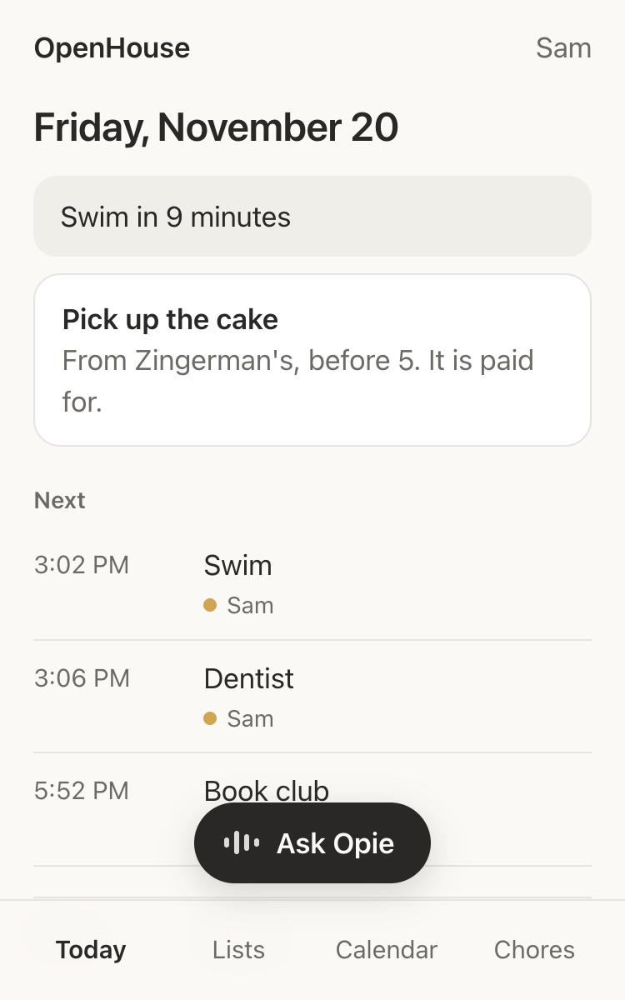
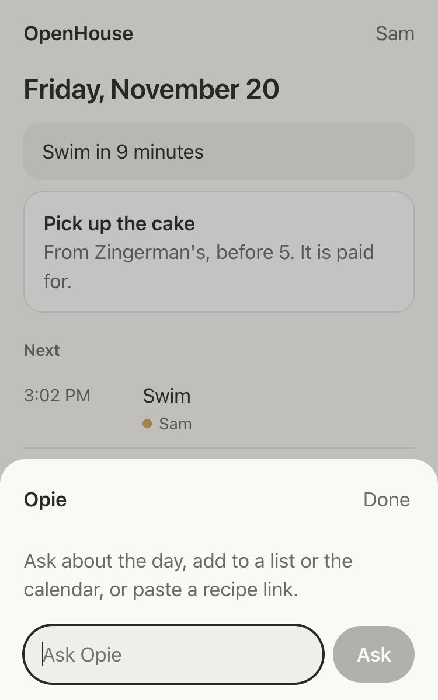
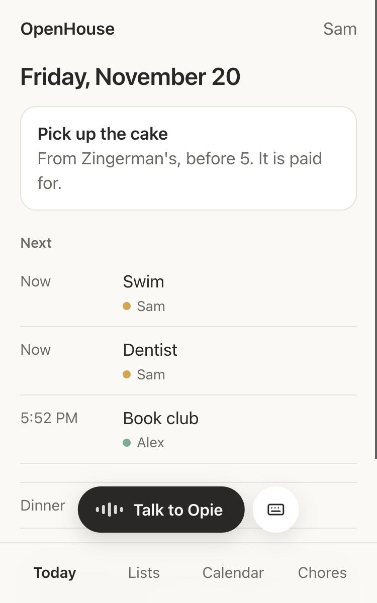

# Opie on a phone

2026-11-20. The story for each person's phone, and what the first slice built. The page is `chat/src/phone.jsx`
(served by the tablet at `/phone/`, and by the cloud at `/h/` through the relay). How it pairs and pushes is in
[phones-and-tv.md](phones-and-tv.md); this is what it is for.

## The story in one line

**Your phone is the house in your pocket, with Opie in it.** The same household as the big screen (today, the lists,
the calendar, the chores), shown for you, and the same Opie, who knows the same things and changes the same lists.
It is not a remote for the tablet and not a second app to learn. With the hub (a box in a closet, no screen), the
phone is the screen, and it is the same page.

## 1. The first minute

Someone opens their invite link (or scans the tablet's code), taps Join, and someone says yes on the tablet. Then:

```
 Opie                       Sam
 Thursday, November 20

 Swim in 15 minutes               ← the things: at most three
 Leave by 4:50 for Ducks at MSU     lines, most urgent first;
                                    tap one, then Got it
 Next
 4:00  Dentist          Sam
 6:30  Book club        Alex
 Tomorrow 8:00  School trip

 Dinner   Tacos
 Yours    Feed Pepper, Unload dishes

 Get a note here when the house      ← once, until it's on
 has one for you.     [Turn on]

          ( Ask Opie )               ← the pill, bottom centre

 Today    Lists    Calendar    Chores
```

- **What matters now comes first**: the things strip the tablet shows (a reminder due, a suggestion like "Leave by
  4:50", a countdown, a broken app), then notes for you, then what's next, dinner, your chores.
- **It's for three things, in this order**: knowing what's on (a glance), the lists at the shop (a tap away, working
  with no signal), and asking Opie from anywhere.
- **Nothing to set up on the phone.** No settings, no account. Turning on notes is the only question, asked once.
  The one exception is the phone the tablet was set up with: it walks through calendars, photos and invites once.

## 2. Talking to Opie from the phone

**Both: type, or tap and talk.** One pill at the bottom centre, like the tablet's.

```
 ┌──────────────────────────────────┐
 │ Is the dentist today or Friday?  │
 │                                  │
 │ Today at 4:00, for Sam.          │
 │                                  │
 │ [ Ask Opie                ] [Ask]│
 │                     (Talk, later)│
 └──────────────────────────────────┘
```

- **Typed** goes to the household's text model (`POST /chat`), with the same tools and the same half hour of talk
  as the tablet's voice, so "the event we just talked about" works across both. Built.
- **A link pasted there** is a recipe for the Recipes box (`/house/recipe-link`). One box, not a separate card.
- **Talk** is the live voice, the same session the tablet runs (`chat/live/live-session.cjs`, through the hub
  session's browser module `chat/src/live-voice.js`): tap the pill to talk, tap again to stop, and the words rise
  above it, as on the tablet. It needs a secure page (the cloud's copy at `/h/`, a hub on https, or localhost) for the
  microphone, and the phone's `voice` scope (someone's phone, not a kid's unless chosen).
- **One pill.** Where voice works, the pill is Talk, with a small keyboard button beside it for the typed sheet.
  Where it doesn't (the plain-http Wi-Fi page, a phone without voice), the pill opens the typed sheet. Built
  (chat/src/talk.jsx, with the hub, docs/hub.md).
- **Who's asking is known.** The phone is someone's, so Opie is told "Sam, on Sam's phone" and never has to ask.
  (Typed turns already carry `who`.)

## 3. Notifications: few, and only yours

A buzz is for something **you** need to do **soon**. Everything else waits on the page.

| Buzz | Not a buzz |
|---|---|
| A note put up for you ("for Sam"). Built. | Anything for nobody in particular |
| A reminder for your event, when it's due ("Dentist in 15 minutes"). Built in this slice. | Countdowns ("Trip in 4 days") |
| "Leave by 4:50" for your event, from the heartbeat. Next. | A broken app (it's on the strip, and the workshop fixes it) |
| A timer you started from this phone, when it ends. Next. | List changes, chores ticked, new photos |
| Your chore with Remind me, at its time if it isn't done yet ("Feed the cat now"). Built. | A chore for anyone (it shows on the device) |
|  | Anything during the household's night hours |

- Each buzz has a tag, so the same thing never buzzes twice; a newer one replaces it.
- An event buzzes the people on it. An event with nobody on it buzzes nobody (the tablet says it out loud).
- **Groceries at the shop**: the list is one tap away and works with no signal; a buzz needs to know where you are,
  which a web page can't do in the background. That's a native-app thing (6), and probably not worth it.
- Sent by the tablet itself (Web Push, encrypted for the phone); our servers never see a note.

## 4. Kids' phones

The same page, with less on it. Chosen when the phone is added (Settings, Devices, Add, Someone's phone, and
whether it can ask Opie).

- **Theirs first**: their chores and stars at the top of Today, their events, notes for them.
- **Opie only if the household said so** when adding the phone (the `ask` scope). On the tablet anyone in the room can
  ask; a phone is alone in a pocket, so it's a choice. Without it there's no pill.
- **No recipe links, no setup, no settings**, on any phone.
- They tick their own chores and add to the lists, as on the tablet.
- The phone page never labels a phone as an adult's or a kid's; the difference is just what's there.

## 5. Away from home

| | On the home Wi-Fi only (no cloud) | Through the relay (cloud linked, Reach from away on) |
|---|---|---|
| Today, lists, calendar, chores | Yes (plain http, at home) | Yes, anywhere |
| Lists with no signal | The last copy; changes wait and go when back | Same |
| On the home screen | No (needs https) | Yes (`/h/`) |
| Notes and reminders that buzz | No | Yes |
| Ask Opie, typed | Yes | Yes |
| Talk to Opie | No (no microphone on http) | Yes, once the voice module lands |

Everything through the relay is sealed on the phone and opened on the tablet (or hub). The relay sees sizes and
times, not words. With no cloud at all, a household still has the Wi-Fi page and loses only the away-from-home,
install, buzz and voice parts.

**Without our cloud: the household's own Tailscale** (Settings → Advanced → Tailscale; [networking.md](networking.md),
"Tailscale, for households without Opie cloud"). While it's on, a phone's QR code opens the tablet at its tailnet
address, `https://opie.<tailnet>.ts.net`, with Tailscale's own certificate: the page's code still comes from the
tablet, and it works at home and away whenever the phone's Tailscale is on (at home too: the address is the
tailnet's). Phones joined on the Wi-Fi's address before keep it, learn the tailnet address the next time they're
home, and go there when the Wi-Fi misses. Sealed the same way; Tailscale carries WireGuard-encrypted bytes it can't
open either.

| | Through the household's Tailscale (no Opie cloud) |
|---|---|
| Today, lists, calendar, chores, ask Opie typed | Yes, anywhere the phone's Tailscale is on |
| On the home screen | Yes, from the https address (not with HTTPS off for the tailnet: then it's `http://<100.x>:8788`) |
| Notes and reminders that buzz | Web Push from the https address, as on the Wi-Fi's https name |
| Talk to Opie | Needs Opie's voice, which is the cloud's |
| List and photo pages from a QR code (the tablet's own Handoff) | Wi-Fi only: they're served on the Wi-Fi's address, which the tailnet doesn't reach |


## 6. Install: a home-screen web app now, native maybe later

**Now: the web app from the cloud, on the home screen.** One page for the tablet, the hub and every phone; updates
with no store; push works on iOS 16.4+ once it's on the home screen.

What a native app would buy, in order of value:
1. **Widgets**: the next thing and the grocery list on the phone's own home screen. The biggest gain.
2. **Siri and Shortcuts**, Google Assistant: "add milk to the list" without opening anything.
3. **Share sheet on iPhone**: share a recipe or a flyer straight in (Android already gets this from the web page).
4. **Notifications that never get dropped**, and timers on the lock screen (Live Activities).
5. Location ("you're at the shop"). Least needed.

Each is a thin native shell around the same page, not a second app. Not before the web app is in daily use:
it needs store accounts and reviews.

**Built (2026-11-23): the iPhone app**, that thin shell, with a share extension, notes by APNs, widgets and Siri:
[iphone-app.md](iphone-app.md).

### From scanning to installed (2026-11-20)

The first real try failed: the copy on the home screen opened without its pairing and said to go back to the tablet.
The cloud page's manifest said `start_url: /h/`, so the installed copy opened at `/h/` with nothing after `#`, and an
iPhone's home screen copy has its own storage, so it knew nothing else. Now:

1. On the tablet: Settings, Devices, Add, Someone's phone, whose, and whether it can ask Opie. A code.
2. The phone's camera scans it. It joins at once: the code was on the tablet's screen, so scanning it is the yes
   (as with an invite link). The tablet's code closes by itself.
3. On a household that reaches home from away, the page goes straight on to the copy from the cloud, which opens on
   one screen: "Put it on your home screen" (Share, Add to Home Screen on an iPhone; one button on Android when
   Chrome offers it, the menu otherwise), and Not now.
4. The home screen copy opens at the same address, pairing and all (the manifest has no `start_url`, so it is the
   page's own), straight into the household. Turning on notes is the one card left.

With no cloud, step 3 stops at the Wi-Fi page (a browser won't install a plain-http page). The setup phone does its
setup steps first, then the same. A copy that still opens with no pairing (one added before this) says how to scan
again; it needs removing and adding again after the cloud deploy.

## Send to Opie from the share sheet (2026-11-22)

- **On an iPhone**: a shortcut, Send to Opie, in the share sheet for links, text and photos. It posts what was shared
  to the cloud's `/send` and shows Opie's answer as a notification. A photo is made a JPEG no wider than 1600 first.
- **On Android**: Opie is already in the share sheet (the page's `share_target`); what's shared goes to Opie the
  same way, and the answer shows in the Opie sheet.
- **What Opie does with it is its call**: it gets "(Shared from their phone's share sheet...)" and the item, as a typed
  turn from that person, with the household's tools (`save_recipe` is new: a recipe's link into the box). A photo is
  described first by the cloud's model, then the description is the item. If it's unclear, one short question. An
  answer within 14 seconds (looking at a photo included) goes straight back; a slower one, or a failure, comes as a message on their phone.
- **How it's sealed**: the shortcut's one setting is a key: `<relay id>.<phone id>.<relay token>.<share key>`. The
  share key comes from the phone's own key (HKDF, "openhouse share"), so removing the phone in Settings ends it. The
  cloud seals what was shared with it and passes it through the relay like any phone's request, and the tablet lets
  that key reach one route, `POST /phone/share`, only for a phone that may ask Opie, and never the same request twice.
  The cloud sees what was shared on its way (it's https to us, not sealed on the phone) and keeps none of it; the
  phone says so before it's set up.
- **Setting it up**: one row on the phone page (the cloud's copy, on an iPhone): Add Send to Opie. It copies the key
  and opens the shortcut; when the shortcut asks for the key, paste.
- **The shortcut file** is made by `openhouse-cloud/scripts/send-shortcut.ts` and has to be signed on a Mac (`--sign`, which uses
  the Mac's iCloud account; Apple signs it) before the service hands it out. Until it's signed the row doesn't show.

Code: `openhouse-cloud/lambda/send.ts`, `bridge/phone-share.js`, `screens.js` (`shareKey`), the `SendToOpie` row in
`chat/src/phone.jsx`. Tests: `bridge/test/phone-share.test.mjs` (what the key opens), `send-to-opie.test.mjs` (the
whole way, with the real bridge and the service).

## Every app on the phone (2026-11-23)

The phone shows the household's own tabs, in the tablet's order (its home style), and each tab is the app itself, not
a phone-only copy of it. Adding a plugin on the tablet adds it to the phone.

- **Navigation.** The first four tabs along the bottom, then More: every tab, in a list that slides in from the side.
  Apps holds every app that isn't a tab; one opens over the tabs with Back. Today is the tablet's own Today (home.jsx)
  in one column, with what's only for this phone's person under it (what Opie was asked to tell them, notes by push,
  Send to Opie). The look is plain on purpose, for the redesign to restyle: `nav`, `.more`, `.more-row`, `.tab-icon`,
  `.appframe`, `.ptoday` in `chat/phone.css` and `phone-today.css`.
- **Each app in a frame of its own** (`chat/src/phone-apps.jsx`, `phone-frame.js`). `<iframe sandbox="allow-scripts
  allow-forms allow-modals">`, with no `allow-same-origin`: the frame has an opaque origin, so it can't read the phone
  page's key or storage, another app's frame, or cookies. Its starting page (`/phone/frame.html` from the tablet,
  `/h/frame.html` from the cloud) is served with `connect-src 'none'` and may be framed only by the phone page, whose
  own `frame-src` is only itself, so an app can't send itself anywhere either.
- **Its files** come in one sealed request, `GET /screens/app-files?app=` (`screens.js` `appFiles`: the app's folder,
  never `app.json` or a dot name, and the kit files it names), and are kept on the phone in IndexedDB by the app's
  version (a hash of its files' names, sizes and times): the first open takes a moment, later ones are instant, with
  no signal too. The frame makes each file a `blob:` URL inside itself, points imports and `url()`s at them, and writes
  the app's page in place of its own. `localStorage` there is kept per app by the phone page. An app that imports an
  installed library (`three`, `phaser`) isn't on phones yet (the tablet's dev server finds those).
- **Every kit call** goes by message to the phone page (`/kit/openhouse.js`, `screen.kind === 'phone'`), which marks
  it with the app of the frame it came from (`event.source`, never what the frame says) and seals it like any of its
  requests (`{a: app}`). The tablet answers it as that app's own call on the tablet (`server.js` `appCall`): its rights
  (`apps.js` `appAllowed`, `/house` cut to its groups by `houseFor`), its own saved things, its `reaches` for the web.
  A phone adds its own limits: a change needs the phone's `arrange` scope, and a phone never makes the tablet speak or
  run a timer for an app. What an app may reach is also cut to the phone's own scopes (`screens.js` `APP_RULES`): the
  everyday changes with `arrange`, recipe links, photo removal, devices and the map only on a phone that may ask Opie (`ask`),
  and the house's settings, where the household lives and the flyer never, on any phone. A frame that tries to go somewhere else is replaced with a fresh one.
- **At home and away the same.** On the Wi-Fi the sealed requests go to the tablet's listener; away, through the
  relay. With no signal an app sees what it last saw of the house (as cut for it), and a tick or an add waits and goes
  when the phone is back, still marked with its app.
- **Where an app runs** is its `app.json` `"screens"`: none means the tablet and the phones; a list means only those
  (`"tablet"`, `"phone"`, `"tv"`). An app that can't do a phone says `"screens": ["tablet"]` and is left off phones.
- **Narrow screens.** `/kit/quiet.css` makes `--u` a phone's size under 700 px wide, so every app that uses it scales;
  `/kit/narrow.css` lays our starting apps out in one column there (Meals' days one under another; Calendar starts on its
  list). Chores and Lists lay themselves out (their own `index.html`): Chores stacks the people one under another, with
  a row of tiles along the top for who has what left (tap one for just theirs, the last one adds a chore); Lists shows
  one list at a time, picked from the names along the top. The example plugins' `base.css` does the same.
- **Round the frame.** An app's frame tells the page its own background (`phone-frame.js`, `{oh: 'bg'}`), and the page
  paints it under the status bar and behind the tabs, so the frame has no edge; Opie's buttons float over the foot of
  the app. The frame stops the apps' unit at a tall phone's, so a wider frame doesn't make their type grow.
- **On its side.** A phone turned on its side (short and wide, `phone.css`): the tabs are a rail down the left inside
  the safe area, Opie's buttons sit at the bottom right, an app's frame takes all the rest, and Today goes to two
  columns, the calendar beside the rest, as on the tablet. The app keeps its phone layout across that width: the kit
  (`openhouse.js`, told by the frame's `kind=phone`) makes what its styles and `matchMedia` say for a phone upright
  (`max-width: 700px` holds, `min-width: 701px` doesn't) hold on its side too, with the unit from the height so the
  type stays the size it is upright. An app asks `matchMedia`, not `innerWidth`, for its phone layout.

Tests: `bridge/test/screens.test.mjs` ("a phone runs the household's apps"): only apps on phones, their files, each
call only what that app may do, one app never reading another's saved things.

Not yet: apps that use installed libraries; the kit's fonts from the cloud's copy (the faces fall back to the
phone's own); photos into Photos from inside an app (`addPhoto` with a file); `say` on the phone itself.

## The first slice (built 2026-11-20)

  

- **Today, cleaner**: the date, the things strip with Got it, notes for you, Next (three), dinner and your chores as
  two short lines, and turning on notes as one quiet card at the bottom. The recipe card is gone from Today.
- **Ask Opie**: the pill at the bottom centre (phones that may ask), opening a sheet; typed questions stream the
  answer; a pasted link goes to Recipes. Talk comes with the hub's browser voice module (in progress).
- **Reminders buzz** the phones of the people on the event, once, outside night hours (`bridge/phone-buzz.js`).
- **Phones can take a thing down** (`/house/thing` is in the `arrange` scope).

Next: Talk on the pill, "leave by" and timers that buzz, and a widget only if a native shell happens.
