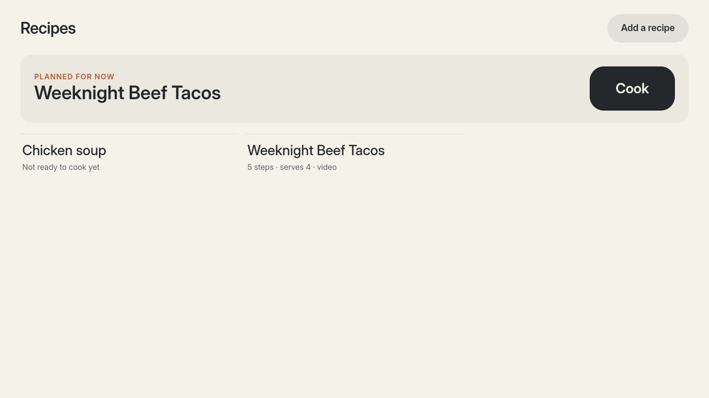
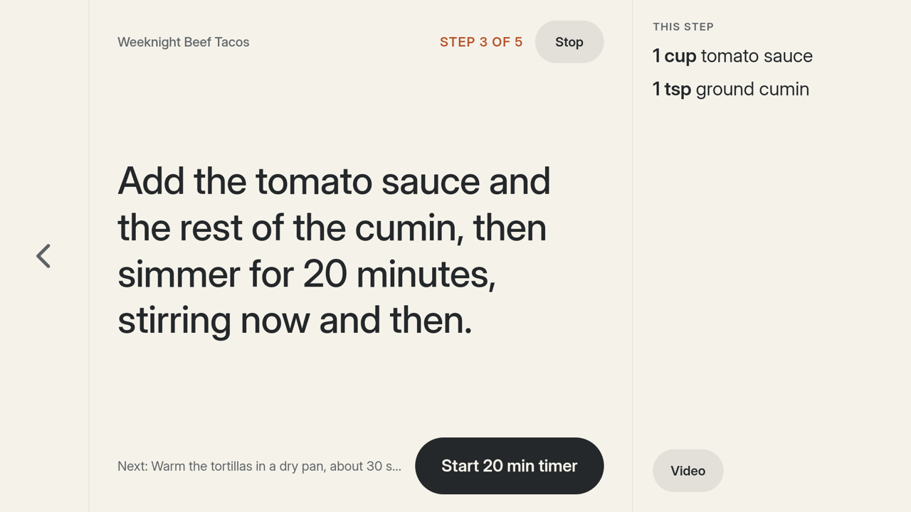

# Recipes: cooking hands-free (built 2026-11-20)

Recipe steps you can follow with messy hands, and videos while you cook.
Recipes is a built-in plugin app (`defaults/apps/recipes`, tab icon `cooking-pot`), and a starting tab after Meals.
Tablets that already chose their tabs keep them; Recipes is in their Apps.

 

## The recipe box: the Meals app's recipes, one store

- The recipes are the Meals app's recipe per meal (`house.js` `data.recipes`). There's no second store. A recipe
  gains two fields:
  - `cook`: its steps.
  - `video`: a YouTube link, from the page or the link itself.
- **Ways in:**
  - A link: typed in Recipes, or shared from an adult's phone. On Android the phone page takes a share
    (`share_target`); on any phone there's a link field on Home. The route is `POST /house/recipe-link`, allowed for
    the `ask` scope only, so not from kids' phones.
  - A photo of a cookbook page (the existing `phone.recipe`).
  - Pasted, or typed in a part at a time (**Type it in**: name, ingredients and steps a line each; link, picture link,
    serves and minutes if they like; `house.addTypedRecipe`, the assistant's `save_recipe` with name and steps).
  - "Write one for me" (the existing `writeRecipe`).
  - The assistant's `set_meals recipes`.
- **Made into steps once** (`bridge/cooking.js`). A recipe is turned into steps whenever it is saved and the assistant
  is on: `{name, serves, ingredients: [{item, amount}], steps: [{text, uses: [{item, amount}], timer?: {minutes,
  label}}]}`.
  - The steps are kept with the recipe, so cooking needs no internet.
  - The same recipe saved again keeps its steps. A changed one is made again; `cook.for` is a hash of its link and
    notes.
- **Reading a link:**
  - The tablet fetches the page the household shared. It uses the page's schema.org `Recipe` (most recipe sites have
    one: sections, amounts, the video), else the page's readable text.
  - A link-only recipe gets that text as its notes, so Meals shows it too.
- **Making the steps:** the household's own text model does it, through `house.js` `answer` (the cloud's gpt-6-luna
  for most households). That's a service they already chose, and nothing new gets their data.
  - The answer is checked by `parseCook`: amounts kept, steps of 400 characters at most, a timer only when a step
    names a time.
- **With no assistant** (2026-11-28) a recipe still cooks, made with no model (`bridge/kit/recipe-text.js`):
  - typed in, or pasted or written in Meals in the shape Opie writes (a line "Ingredients", one a line, a line
    "Steps", numbered steps; "Directions", "Instructions" or "Method" do for Steps; without headings, "- " lines are
    ingredients and numbered lines steps);
  - a link whose page carries its schema.org `Recipe`: its own name, ingredients and steps, used as they are. A page
    without one says to paste or type it in.
  - Such steps have no per-step amounts or titles; a step that names a time ("simmer 20 minutes") gets a timer. The
    cooking view needs only each step's text.
  - With an assistant, links and pastes are still made into steps by the model (the page's own data if the model
    fails). Ideas, cookbook photos, pages without a `Recipe` and web search need it.
- **How the steps were made** is kept (`cook.by`: `hand`, `page` or `model`). Steps the household wrote (`hand`, and
  the recipe's `hand`) are read again as written when the recipe changes, never by the model; **Make the steps again**
  on them asks "Replace your steps with Opie's?" first.
- The assistant's tools see how many steps a recipe has and what it needs to buy (`needs`), never the steps
  themselves (`family_things`).

**Taking one out:** a recipe's card has **Take it out**, then "Take out Tacos?" with **Keep it** or **Take it out**.
It's the same recipe as the Meals app's, so it leaves that meal too (`house.setRecipe(meal, {})`). A recipe being
cooked stops.

## Finding a recipe (2026-11-20)

**A new one, from the web**
- "Hey Opie, find a good weeknight chili" (voice action `find`), or the **Find a recipe** field then Enter or
  **Search the web**.
- The bridge asks the household's text model with OpenAI's web search on (`house.js` `findRecipes`). The cloud passes
  `webSearch` on to OpenAI as its `web_search` tool, and counts each search at $0.01 (`VOICE.searchPerCall`) plus the
  tokens. Nothing goes anywhere else.
- Each page it names (up to 6, https only) is read on the tablet for its picture, total time and whether it holds a
  recipe. Pages with a recipe come first, and 4 show (`recipeFind`, not kept).
- The pictures load straight from the recipe sites (no referrer), with no other image service.
- The voice waits for them (`"wait": 28` on the action; a plugin's answer action can now wait up to 30 s) and reads
  them: "Here are 4, on the screen. One: The Best Weeknight Chili, from Serious Eats, 1 hour 15 minutes…".
- Tap one, or "the second one" (`choose`): it goes into the recipe box under its title, is made into steps, and opens.
  "Let's make it" (`cook` with no name) cooks the one chosen last (for 30 minutes), else what's planned now.

**A saved one**
- Typing in the field narrows the box as you type: by name and by ingredients, plus favorite meals by name (marked as
  having no recipe yet).
- "What can I make with chicken and rice?" (`look`) shows the same and answers: "You could make Chicken soup. Also
  Chicken and rice bowls from your favorites, with no recipe saved yet."
- Nothing found offers **Search the web for …**.

**While it looks** (a search with nothing on screen looks broken):
- The moment a search starts, the Recipes screen says "Looking for bolognese…" with a quiet line moving under it and
  four empty spaces where the options will go.
- A search that fails or finds nothing says so there, with **Try again**.
- A voice search shows the Recipes tab, and wakes a resting screen first (`Openhouse.kt`: any tab or app Opie opens).
- The page looks for voice actions every second (every 2 s before), and each found page gets 5 s to be read (8 s
  before), so the voice more often has the options to read out within its wait.

**Not tried:** a real web search. The emulator has no assistant. Tests fake the model and the pages
(`bridge/test/recipes.test.mjs`, `openhouse-cloud/test/app.test.ts`), and the screen was checked in a stand-in page with fake
results.

## Pictures (2026-11-20; real pictures from the recipe pages, not made ones)

- A recipe saved from a link keeps its page's own photos, read from the page's schema.org Recipe (`cooking.js`):
  - the dish (`image`, else og:image): on the recipe box card, and beside "You need" before step 1;
  - a step's own photo, when the site gives one (`HowToStep.image`): beside that step, above "This step".
- The model splits and rewords steps, so each photo goes to the step that shares most of its words (at least 40%;
  `withPictures`). A photo with no step like it isn't used.
- They load from the recipe's own site (https only, no referrer). Nothing else is asked for or made.
- A recipe made into steps before this gets its pictures once, from its page, the first time it's cooked (no model).
- Recipes from a photo, typed in, or written by Opie have no pictures. Neither does a site that gives none. Made
  pictures were considered and not chosen: a drawn step can show the wrong thing.
- When the video is showing, it takes the photo's place.

## Cooking view

- One step at a time in big type. Beside it: that step's ingredients and amounts, or everything before step 1.
- The step number is at the top, the next step in small type at the bottom.
- **The whole screen is Next.** A tap, or a slide of under 40 px, counts (a wrist or an elbow), and `touch-action:
  none` stops a wet slide from being taken as a scroll.
- Back is the strip down the left side (150 u wide, the whole height). Stop is at the top right. There are no small
  controls.
- **Timers:** a step that names a time gets a big **Start 20 min timer** button, or Opie offers it ("Want a
  20-minute timer?"). The timers are the home screen's timers (`timer.start`), named after the step ("Simmer the
  filling"), and several can run at once. They show in the home screen's column and ring as always.
- **Where you are** is kept in the app's store, so a reload or a restart mid-cook carries on (for 3 hours).

## Opie drives it

Recipes declares its voice actions in `app.json`, the way any plugin does:
- `cook {recipe?}`
- `step {go: next|back|again|ahead|first}`
- `how_much {ingredient}`
- `ingredients {all?}`
- `timer {minutes?}`
- `video {do}`
- `stop`

**Voice actions with an answer (new, for any plugin).**
- An action with `"answer": true` is answered by the app's own page. What its `onAction` handler returns is what the
  voice says.
- The bridge waits up to 6 s for `appdata/<app>/replies.json`.
- So "next" moves the screen and the voice reads the step that is now on it ("Step 3 of 8. Add the tomato sauce…
  Want a 20-minute timer?").
- "How much cumin?" answers from the recipe: "1 tsp ground cumin in this step; 2 tsp in all."
- Moves go through one set of functions (`defaults/apps/recipes/cook.js`), so taps and voice never disagree. On the
  emulator a voice action came back in 0.2–0.5 s with the app open, and under 2 s from the home screen.

**Starting a cook:**
- "Let's make the tacos" matches the recipe by its meal name or its own name. Saying none takes the meal planned for
  now.
- Opie shows its tab, or its own window where it isn't a tab (`homeScreen.showApp`, `home.jsx`).
- Meals' recipe card and day sheet have **Cook**. It goes through `POST /apps/ask`: one of the household's own apps,
  or ours, asks another to do one of its declared actions.
- A recipe with no steps yet is made ready on the spot. Cooking starts by itself when the steps are done.

## Listening while cooking: what was chosen, and what it costs

While cooking, the app says it's in use hands-free (`kit handsFree`, `POST /home/handsfree`):
- The screen stays on. The shell's resting screen waits (`Openhouse.kt`).
- When a live session opens, `/live/setup` tells the voice what's on the screen (the step, what it uses, the timer
  it offers, the next step) and that short things said without its name are for it.
- `/live/setup` also returns `quietS`. The tablet ends a session itself after that much quiet (`LiveVoice.kt`; 8 s
  otherwise).

**Chosen:** while cooking, a session ends **30 s** after the last words (the cap here), not 8. For 30 s after Opie
reads a step, "next", "how much salt?" or "again" work without the name. Then it ends as usual, and the next one is
"Opie, next".

**The cost, from the cloud's own rates** (`openhouse-cloud/lambda/app.ts`: GPT-Live $0.05 a minute active and $0.02 in
standby, per second, plus the first 15 s at start). Our counter charges it all as active. Take a 40-minute cook with
8 steps and about 12 things asked (8 nexts, a couple of "how much", a timer, an "again"):

| How it listens | Live time | On our counter | Notes |
|---|---|---|---|
| The name every time (8 s after the last words) | about 12 × 20 s ≈ 4 min | about $0.20 | each ask is a session |
| **30 s after the last words (chosen)** | about 8 × 40 s + 4 asks inside a window ≈ 6 min | **about $0.28** | follow-ups share a session; much of it is quiet, which OpenAI bills as standby |
| Open the whole cook | 40 min, in 5-minute sessions | about $2.00 | hears the room the whole time |

- The window costs about $0.08 more a cook than saying the name each time.
- Opening the whole cook would be about 7 times more, and it would hear the room for 40 minutes.
- The household's $10 a month covers about 35 cooks like this, if every step is asked aloud.
- **Not measured on a tablet.** The emulator can't run a live session (WebRTC). The figures are the cloud's rates
  times the timings above.
- The tablet's usage report (`/cloud/live/usage`, OpenAI's own seconds) gives the real number after a real cook.
  That's worth checking once.

**Parked (2026-11-20): standby for the whole cook.**
- GPT-Live's standby keeps the session open after `idle_timeout_s` (`session.paused`), with the microphone live. It
  wakes on any speech (`wake_policy: speech`), and costs $0.02 a minute against $0.05 active.
- A whole 40-minute cook in standby would be about $0.95 on OpenAI's bill. "Next" would work at any time without the
  name.
- But any talk in the room wakes it and is heard.
- If it comes back, it would be a per-cook "keep listening" switch:
  - The tablet doesn't end the session on `session.paused` while cooking, and lifts the 5-minute cap.
  - The cloud's counter bills standby at $0.02; it counts it as active today.

## Videos

- A recipe with a YouTube video (from the page's schema.org data, or a YouTube link) gets **Video** in the cooking
  view. It's a player beside the steps, kept in place as the steps change.
- Opie drives it with `video {show|play|pause|back|hide}`, through YouTube's IFrame API.
- Tried on the emulator: it plays, keeps playing from step to step, pauses, and goes back ten seconds.
- Some videos can't be embedded, and YouTube says so in the player.
- **The TV:** the existing `tv` tool already pauses, plays and changes the volume by voice ("Opie, pause the TV").
  The TV drivers can open the YouTube app but not a given video, so a recipe's video on the TV isn't built.
- **Instagram:** can't be controlled. Not tried.

## Not done

- **On a real tablet:** not tried. It needs runtime-assets plus an APK build (bridge, kit, app, `home.jsx`,
  phone page, `LiveVoice.kt`, `Openhouse.kt`). No cloud deploy is needed.
- **The 30 s window with a real voice:** whether "next" without the name is caught reliably, and whether the voice
  stays quiet for talk in the room, needs a try on the tablet.
- **The screen staying on** for a whole cook: built (the home screen's `handsFree` keeps the resting screen away) but not
  waited out on the emulator.
