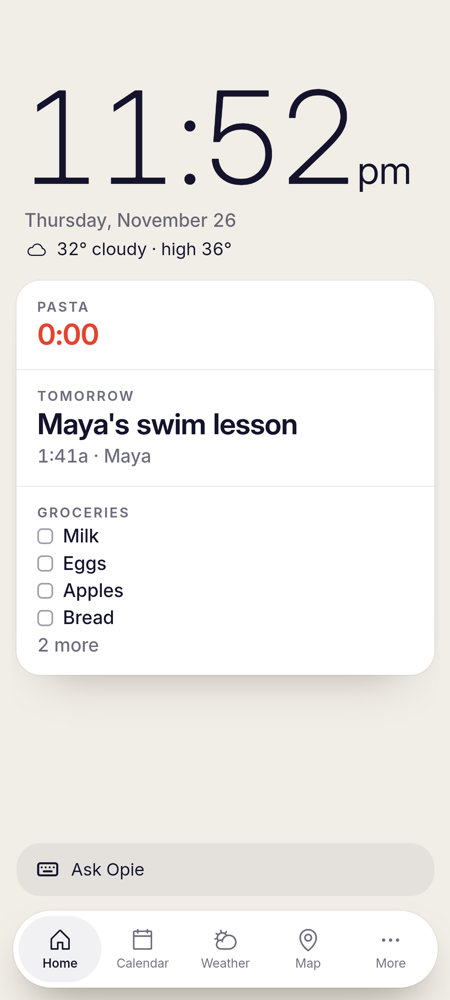

# Tablets for Opie

Opie runs on an Android tablet you buy yourself. This is the short list of the ones we know about. To set one up,
follow [the setup guide](setup.md).

| Tablet | State | Since |
|---|---|---|
| **Samsung Galaxy Tab S10 FE**, Wi-Fi (SM-X520) | **Works** | Opie is built on it. Release and date of its full test run: to be recorded |
| **Samsung Galaxy Tab A11+**, Wi-Fi (SM-X230) | **Being tested** | Voice fixes for it are in. It moves up once its results are in [hardware.md](hardware.md) |
| **Lenovo Tab One**, Wi-Fi (4 GB) | **Being tested** | Setup by code, linking to Opie Cloud, voice and the home screen all worked on 1.0.55 (2026-11-27) |
| **Xiaomi** tablets on HyperOS (Redmi Pad 2 Pro and others) | **Doesn't work** | HyperOS refuses the setup that makes Opie the tablet's owner, and lets Home leave kiosk mode |
| Anything else | Not tried | Tell us what happened: [the "My model" form](https://github.com/mrubens/opie/issues/new?template=my-model.yml) |

What the states mean:

- **Works**: all eight tests in [hardware.md](hardware.md) ("What to test on each") passed on a named release, which is
  written here with the date. The device itself says nothing about the list: any device can be set up.
- **Being tested**: we have one and are running those tests. It may work fine; we just can't say yet.
- **Doesn't work**: it failed a test that can't be worked around, so don't buy one for Opie.

Prices change too fast to list. When a price appears in this repo it carries its date (as in [hardware.md](hardware.md)).

## Guides per model

Each one has the setup, the charge limit, and the way back to an ordinary tablet. They're written from the code and
[the setup guide](setup.md), so each says so until someone has gone through it on that model, start to finish. Then
the line changes to "Walked through on release …, date …".

### Samsung Galaxy Tab S10 FE (SM-X520)

Not yet walked through on this model: written from the code (release 1.0.75).

**Setup**

1. Remove every account: Settings → Accounts and backup → Manage accounts → each account → Remove account. Then
   Settings → General management → Reset → Factory data reset. A new tablet in its box skips this.
2. On the first welcome screen, tap the same spot six times. A code scanner opens.
3. Connect to Wi-Fi if it asks, then scan the code on [opie.house/setup](https://opie.house/setup) (or the one on
   your account page, which links the tablet to your household).
4. Tap Accept, Next or Continue through "This device belongs to your organization" and the screens after it.
5. Wait, plugged in: Android downloads Opie, then Opie's software (about 210 MB), then **Getting Opie ready**.
6. **Welcome to Opie** → **Get started**. If the tablet has no Wi-Fi yet, **Join Wi-Fi** comes first.
7. **Set up on your phone or computer**: scan the code with a phone, or type the address and code on a computer, and
   tap Allow on the tablet. The phone or computer then takes you through **Who lives here?**, **Where do you live?**,
   **Do you have a shared calendar?**, **Put your photos on the device?** and **Choose a PIN** (it can't be skipped).
8. **Two Android settings**, on the tablet: **Let Opie use other apps** (Open Android's settings → Opie assistant →
   switch it on → Allow → Home) and **Stop charging at 80%** (below). Then Done.
9. On a tablet linked to an Opie account: **Opie is ready**. Then the home screen.

**The charge limit**

Settings → Battery → Battery protection → **Maximum** (80%). The setup's step shows this path on any Samsung. Opie
itself doesn't limit charging: it only reads the battery level for the home screen.

**The way back out**

- **Leave kiosk mode**: Settings → Advanced → **Leave kiosk mode**, with the PIN. Android's own home screen and bars
  come back, but Opie is still the tablet's owner, and opening Opie from its icon puts kiosk mode back on.
- **An ordinary tablet again**: Settings → Advanced → **Erase this device**, with the PIN. It unlinks the tablet from
  the account and resets it; it starts again at Android's welcome screen with Opie gone. Opie has no way to stop
  being the owner short of this.
- **Opie won't open**: Samsung's recovery menu refuses the wipe while Opie owns the tablet, so Opie lets it through
  once its home screen hasn't come up for 10 minutes. Turn it on, wait 10 minutes, turn it off, then hold power and
  volume up for the recovery menu and choose Wipe data / factory reset. The keys are the usual Samsung ones, not yet
  tried here.

### Samsung Galaxy Tab A11+ (SM-X230)

Not yet walked through on this model: written from the code (release 1.0.75).

**Setup**

As the Tab S10 FE's: the same One UI 8, so the same account and reset paths, and the setup's step shows the Samsung
path for the charge limit. Nothing in the code or docs records a difference for this model.

**The charge limit**

Settings → Battery → Battery protection → **Maximum**, as on the S10 FE (the same One UI). Not yet seen on this one.

**The way back out**

As the Tab S10 FE's: **Leave kiosk mode** or **Erase this device** in Settings → Advanced, with the PIN; recovery
after 10 minutes if Opie won't open.

### Lenovo Tab One (4 GB)

Not yet walked through on this model: written from the code (release 1.0.75). Setup by code worked on 1.0.55
(2026-11-27), but not step by step against this list.

**Setup**

As the Tab S10 FE's, except:

1. Remove accounts in Settings → Accounts, then reset: Settings → System → Reset options → Erase all data (the setup
   guide's path for tablets that aren't Samsung; not checked on this one).
2. The setup's **Stop charging at 80%** shows no path, only "In Battery, turn on a charge limit or battery
   protection".

**The charge limit**

(path not yet recorded). Whether this model has one at all isn't known yet. When you find it, write it here and in
"The charge limit on each" below.

**The way back out**

**Leave kiosk mode** or **Erase this device** in Settings → Advanced, with the PIN, as on the S10 FE. If Opie won't
open: the same 10-minute wait, then the recovery menu (keys not yet recorded for this model).

### Xiaomi tablets on HyperOS

Not yet walked through on this model: written from the docs (release 1.0.75).

The setup stops at the code: HyperOS refuses to make Opie the tablet's owner, or says it can't set up a work device.
Even where it gets past that, Home leaves kiosk mode. Reset it from Android's settings and use it as a normal tablet.

## A spare phone

The same app runs on an Android phone, as the household's hub or a small panel on a counter or wall. A phone is any
screen whose short side is under 600 dp (`Calm.compact` in the shell, `useCompact` in `chat/src/home.jsx`); a tablet
never is, and stays exactly as it was. On a phone:

- It turns upright as well as sideways (the manifest keeps tablets sideways; `MainActivity` lets a phone turn).
- Sizes come from the short side: 560 u across it, upright or not (a tablet's long side is 1536 u). The home page's
  `--u` and the shell's `u` follow the same rule, and the apps in tabs take their own phone layout (`narrow.css`).
  Cards drawn for a tablet are no wider than the screen (`fit()` in `Theme.kt`, and dialogs).
- Home is a glance in big type: the time and the day, the weather, then what's on now (cooking, timers, what's next on
  the calendar, the shopping list) and asking Opie. Upright, the first four tabs are on a bar along the foot and More
  has the rest, sleep and Settings; sideways, the rail has the tabs.
- An app in a tab gets `compact=1` in its address, and keeps its phone layout on its side too, across the whole width
  (the kit, as on a phone's page: [phones.md](phones.md), "On its side").

Not tried on a real phone yet: the emulator only (a Pixel 7's screen).

Setting one up, as the code has it: the same as a tablet's. The six taps and the code, the same setup steps, the
charge limit in Android's settings (the Samsung path on a Samsung, else none), and the same way back out (Settings →
Advanced → **Erase this device**). Not yet walked through on a phone: written from the code (release 1.0.75).

## Trying a tablet that isn't listed

It has a fair chance of working if it has:

- **Android 10 or later.** That's the least the app installs on. Android 15 or 16, with years of security updates
  still to come, is what we'd buy.
- **Setup by QR code as the device owner.** Android's own: tap the first welcome screen six times and a code scanner
  opens. Most tablets with Google's Android have it; some makers' own versions remove or break it (Xiaomi's HyperOS).
- **4 GB of memory or more.** Opie itself needs little now that speech runs in the cloud; 4 GB runs it (the Lenovo Tab
  One), and 6 GB leaves room for bigger apps.
- **A charge limit**, since it stays plugged in. Not needed, but the battery lasts longer.

Then follow [the setup guide](setup.md) and fill in [the "My model" form](https://github.com/mrubens/opie/issues/new?template=my-model.yml)
either way. A tablet that works for several people is one we'll test.

## The charge limit on each

The setup's "Two of Android's settings" step opens Android's settings; this is where the limit is.

- **Samsung (One UI 8: the Tab S10 FE and A11+):** Settings → Battery → Battery protection → **Maximum**, which stops
  charging at 80% (One UI lets some models choose 80–95%). "Basic" charges to 100% and only tops up from 95%.
- **Others:** look in Battery for "charge limit", "battery protection" or "optimized charging". Tell us the path on
  the form and we'll add it here.

## For whoever updates this list

- A model moves to **Works** only with the eight tests' results in [hardware.md](hardware.md), and the release they ran
  on and the date written in the table above.
- Keep the list to two or three models. No household details here (the repo's `CLAUDE.md`).
