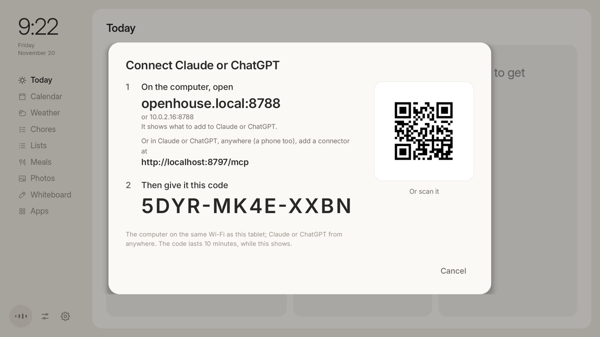
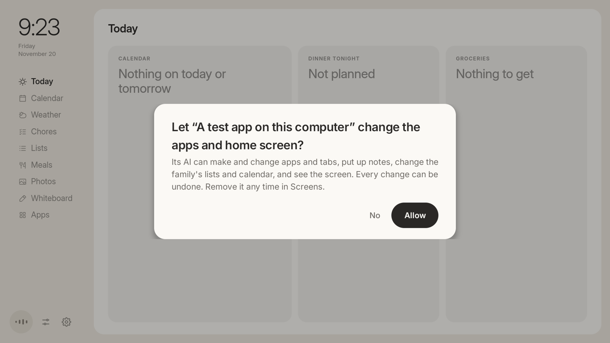
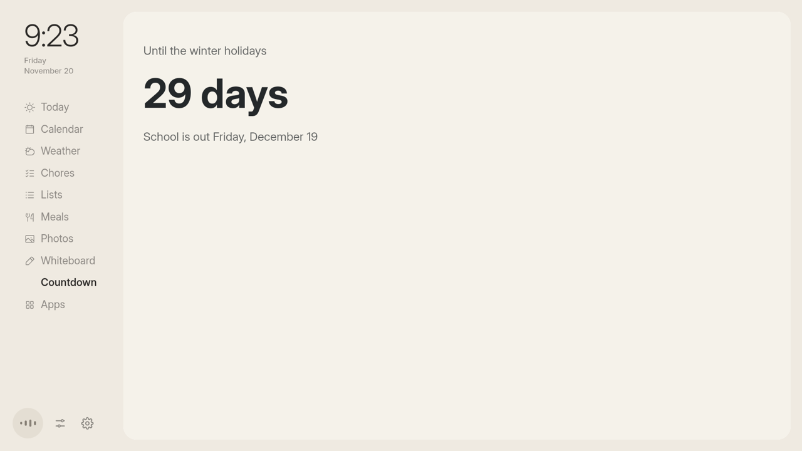

# Changing OpenHouse from claude.ai or ChatGPT (the web connector)

Status (2026-11-20): **works with the real claude.ai** on a real tablet (1.0.9-local.11): sign-in with the
tablet's code and Allow, then tool calls through the relay. Deployed at `https://cloud.openhouse.computer/mcp`. The
first try failed because the relay passed a reply's pieces on out of order (see "Lessons" below); that's fixed.
ChatGPT works too (signed in through its client-ID metadata document, answered from the tablet in a chat). Still to try: the Claude phone app. The cloud's log of that try
had one `resources/list` time out after 25 s, cause not known yet, and Claude probing `server/discover`, which the
workshop doesn't answer. Neither stopped it.

## The goal

Someone who has only ChatGPT (chatgpt.com or its app) or Claude (claude.ai or its app) can change their OpenHouse
screen: add or change apps and tabs, change the look, and make and share plugins. That works from a phone too. They
need no Claude Code, no Codex, no computer set up and no file to install.

And beyond building: any agent can use the house day to day, and be more of someone's interface to it. A
long-running cloud agent with memory, present on all of someone's devices, connects the same way, and can do anything you could say to the tablet's voice: add
milk, set a pasta timer, put a note on Today, check the weather, turn off the TV.

Today that takes Claude Desktop, Claude Code or Codex on a computer on the home Wi-Fi ([workshop-mcp.md](workshop-mcp.md)).
Those connect through a local MCP that pairs and seals. claude.ai and ChatGPT can't run a local program. Their
connectors are remote MCP servers on a public https address behind OAuth, so the reachable end has to be in our cloud.

## What the person does

Once, on the tablet: **the gear → Account** must be linked to an OpenHouse account, with **Reach from away
from home** on. The connector reaches the tablet through the relay ([networking.md](networking.md)).

Then the same screen that pairs a Mac does it. **The gear → Screens and computers → Add a screen → A
computer, to change the apps.** With the relay up, that screen is titled **Connect Claude or ChatGPT**. It shows the
connector address next to the usual code:



**In Claude** (claude.ai, or the Claude desktop app; any plan, and Free allows one custom connector):

1. Settings → Connectors (Customize → Connectors) → **Add custom connector**. Name: OpenHouse. URL:
   `https://cloud.openhouse.computer/mcp`. Add, then **Connect**.
2. A page from OpenHouse opens: "Connect Claude to your OpenHouse". Type the code the tablet shows and press Connect.
3. The tablet asks **Let "Claude" use this OpenHouse?** Tap **Allow**. The page says "Connected" and goes back to
   Claude.
4. In any chat, on the web, the desktop app or the **Claude phone app**, turn on OpenHouse in the tools menu and ask:
   "Add a countdown tab to the winter holidays." Claude asks before using a tool until you choose "Always allow"
   for it.

Claude's docs only describe adding a connector on the web and desktop; once added, it works in the phone app too. We
haven't checked whether it can be added from the phone app.

**In ChatGPT** (chatgpt.com; works on a real account, 2026-11-20):

1. **chatgpt.com/plugins** → **Add** (top right) → **Add custom MCP server**. Name: OpenHouse. URL:
   `https://cloud.openhouse.computer/mcp`. Authentication: OAuth. There was no developer-mode switch to turn on
   first on the account tried (a "Work" profile).
2. Steps 2 and 3 above: the code, then **Allow** on the tablet, which names "ChatGPT".
3. In a chat, pick OpenHouse and ask. ChatGPT asks before each tool that changes something; "Remember" holds for the
   rest of that chat. Tools that only look are marked read-only, so they don't ask.

ChatGPT signed in through its client-ID metadata document (`https://chatgpt.com/oauth/client.json`). Which plans
offer "Add custom MCP server" is still unverified; the one tried is a work account.

**Any other agent** that takes a remote MCP server with OAuth (a long-running cloud agent, a home bot) uses the same
address and steps. Its sign-in has to return to a known address: today claude.ai, claude.com and chatgpt.com, the
`connectorHosts` setting (`REDIRECT_HOSTS` in `connector.ts`). Another agent's address is one line to add, once we
know it.

**Removing it:** on the tablet it is listed under Screens and computers ("Claude · computer"), like a Mac. Removing it there ends its access at once: the next call is refused, and the
connector asks to sign in again.

## How it works

```
claude.ai / ChatGPT (their servers)
   │  https, OAuth 2.1 (PKCE S256; DCR or a client-ID metadata document), Bearer token
   ▼
cloud.openhouse.computer   (the existing HTTP API and Lambda: openhouse-cloud/lambda/connector.ts)
   │  /.well-known/oauth-*, /oauth/authorize|pair|wait|token|register, POST /mcp
   │  each MCP message sealed with this connector's own key, as a paired computer would seal it
   ▼
relay.openhouse.computer   (the existing WebSocket relay: openhouse-cloud/lambda/relay.ts)
   ▼
the tablet's bridge: relay.js → screens.js (/s, scope "workshop") → workshop.js (/workshop/mcp)
```

- **One MCP server.** The connector runs no tools. Every message goes to the tablet's own workshop, the same route a
  Mac reaches, so the tool list, the guide, the edit lock and undo are the same everywhere.
- **Signing in is pairing.** The OAuth sign-in page asks for the tablet's code. The code stands for a pairing id and
  a one-time key through scrypt (`bridge/pair-code.js`; `connector.ts` has a copy that a test keeps equal). While
  its Connect screen is open, the tablet tells the relay that pairing is open (`{t: 'pairing', pair, on}`). Only
  someone with the code can compute the id. The page then does the pairing's two steps through the relay (new
  relay role `pairing`, steps `hello` and `wait`), and the tablet handles them with the same code as on the Wi-Fi
  (`screens.pairRelayed`). Someone's **Allow** is still the gate, as on the Wi-Fi.
- **The name on the tablet** comes from where the sign-in sends people back: claude.ai or claude.com → "Claude",
  chatgpt.com → "ChatGPT". Only those addresses may register (plus localhost for tests), so a stranger can't make the
  tablet ask "Let 'Mum's laptop'…".
- **Tokens.** Access tokens last a day. Refresh tokens rotate on every use; the old one stays good for a minute.
  Both carry a grant secret that the table doesn't hold. The connector's device key is kept sealed with that secret,
  so a copy of the table opens nothing. The authorization response includes `iss` (RFC 9207), which ChatGPT
  prefers. Both client-registration styles work: Dynamic Client Registration and client-ID metadata documents
  (CIMD), which Claude and ChatGPT both now prefer.
- **No new infrastructure.** The routes live on the existing HTTP API and Lambda. The relay, the table and the
  domain stay as they are. A call has 25 seconds (under API Gateway's 30). Claude allows tool calls 240 seconds.
  Everything the workshop does is far under that: about 60 ms per call through the relay on the emulator, about 7 s
  for `check_build`. A rare wait on the edit lock returns "still working, look before trying again".

## Using the house, not just building it

The connector gives an agent the household's tools, the same ones the tablet's live voice has (`bridge/live-tools.js`),
so whatever you could say to Opie, an agent can do:

| What | Tools | Hint |
| --- | --- | --- |
| The household | `about_household`, `family_things` (lists, chores, meals, events at a glance), `remember_preference`, `forget_preference` | reads are read-only |
| Lists, chores and stars, routines, meals | `change_list`, `change_chores`, `change_rewards`, `change_routines`, `set_meals` | writes |
| The calendar | `calendar_event` (add, change, remove; reminders go with events) | write |
| Notes on Today | `look_at_notes`, `put_note`, `update_note`, `take_down_note`, `put_back` | take down: destructive |
| Timers | `timer` (start "Pasta" 10 minutes, list, cancel); the tablet rings them | write |
| The weather | `weather` | read-only |
| The TV | `tv` (on, off, pause, volume, open an app), when there's a TV | open world |
| The other devices | `list_devices`, `device_info`, `scan`, `device_action`, `name_device` (not recipes: teaching a device is building) | `device_action`: open world |
| The apps' voice actions | each plugin's own (`"actions"` in its `app.json`), e.g. a pasta timer app's `start` | write |
| Seeing it | `look_at_tablet`, `show_on_tablet`, `get_guide` | read-only |

Actions that turn something on, open something or buy something ask the people in the room first, as they do for the
voice. Separate reminders don't exist yet: a reminder is a calendar event's, or a note on Today.

**One kind of yes.** We tried two (2026-11-20): "Just the household" or "Everything", chosen at Allow. It was
confusing, so there's one plain Allow: a connection can use the
household and build.

## What the model sees

- **`get_guide`**: the home screen as it is now, how to work, and how apps are made. ChatGPT reads the server's
  `instructions` (keep the key points in the first 512 characters; they already are). Claude's docs don't say
  whether Claude does, so the tool is the dependable way.
- **`look_at_tablet`**: a picture of the screen, the screen as text, and, while a change is open and its app is
  showing, the errors the app threw since the last save. Claude takes image results. ChatGPT may not show images
  to the model (community reports; no official statement), so the text part matters.
  **Gap:** it needs the tablet's "Device control" switch (the device tools), which is off by default. On the
  emulator it answered "Device control is off". See the improvements below.
- **The tablet itself**, if the person is in the kitchen: the "From Claude: …" line while the change is open, then
  the new tab.

## Safety

- **One change at a time, and every change can be undone.** The connector goes through `start_editing` and
  `done_editing` under the same lock as everyone else. `undo_latest`, or "undo" on the tablet, takes a change back.
  A change left open goes in by itself after 10 quiet minutes, so a closed phone never blocks the family's assistant.
  Fixes the tablet noticed still need a yes on the tablet.
- **One route.** A connector is a paired computer with the scope `workshop`: one route, `/workshop/mcp`. No backups, screens, cloud settings or the voice. The devices are reachable only
  through their own tools, and anything that turns on, opens or buys asks the room first.
- **Family data goes only to the AI the person chose.** Through the tools, Claude or ChatGPT can read what the
  household keeps (lists, chores, the calendar, the guide's description of the home screen). The sign-in page says
  so before the code is typed, and the Allow on the tablet says so again.
- **What changes about trust, said plainly.** A Mac seals to the tablet with its own key, so the relay sees nothing.
  A web connector can't seal, so **our service holds the connector's key and sees its MCP messages in the clear**
  while passing them on: the family's lists when a tool reads them, and the app files being written. It keeps
  nothing of them and logs no bodies. A compromised service could send that household's tablet workshop calls, and
  no more. The tablet's Allow, its Screens list (remove = refused at once) and its undo stay the gates. This needs to
  be in the privacy page before launch.
- **Abuse limits.** Registration: 20 a minute per address. Code tries: 10 a minute per address. A pairing ends
  after 5 wrong hellos, and an id that isn't showing never reaches a tablet.

## Free for everyone, with or without our cloud

Building from Claude or ChatGPT (or any AI) is free for everyone with the right networking setup (decided
2026-11-20). So:

- **Through our cloud:** free, always, after the first year too, whether or not they subscribe. It needs only a
  linked tablet with Use it away from home on. Nothing in the connector or the relay checks a subscription or an
  allowance (checked 2026-11-20: `relay.ts` and `connector.ts` only ask that the tablet is linked), and nothing should.
  It costs us about two cents a tablet-month.
- **With no OpenHouse cloud at all: "Your own address".** The tablet serves the same connector itself
  (`bridge/web-mcp.js`): the same OAuth sign-in with the tablet's code and Allow, and MCP straight into the workshop.
  It runs on a listener of its own, port 8789, which answers only OAuth and `/mcp`: no screens, pairing or files. It
  is off until someone turns it on with an https address. Your own networking makes that port public over
  https, for example:
  - **Tailscale Funnel** on an always-on computer at home (a NUC, a Mac mini, a Homebridge box):
    `tailscale funnel --bg http://<tablet's address>:8789` gives `https://<machine>.<tailnet>.ts.net`. Funnel on the
    tablet itself would need Tailscale's Android app to serve another app's port. Not checked.
  - **A Cloudflare Tunnel**, `cloudflared` on that computer, pointing a hostname at `http://<tablet>:8789`.
  - **Their own domain and a reverse proxy** (Caddy, nginx) with a certificate, forwarding to the tablet's port 8789.

  On the tablet: the gear → Screens and computers → Add a screen → A computer, to change the apps → **Your
  own address**, type the https address, Turn on. The address is shown there from then on. Then, in Claude or
  ChatGPT, add `<that address>/mcp` as a connector and sign in with the code, as with ours.

  Differences from our connector: the key never leaves the tablet (MCP calls go straight to the workshop as that
  paired computer), so nothing of the household passes through our servers. The household's tunnel is what the
  internet reaches, so its security is theirs: the listener is only OAuth and MCP, it refuses everything without a
  token, code tries are limited per address, and removing the connector in Screens ends it at once.
- **No internet way in at all:** Claude Desktop, Claude Code or Codex on the home Wi-Fi, as before
  ([workshop-mcp.md](workshop-mcp.md)).
- **Self-installers on AWS** could, if the hosted service is ever published, deploy it into their own account, with their own connector address.

## What Lamp does that carries over

Lamp makes building from a chat feel easy and safe through a tight loop: it says what it's changing ("changing:
Rain on the roads"), puts the change in live, and then `look` waits for the change to land and answers in one go
with how it went in, a picture, the screen as text, and the errors and log since the last look. Changes go in live
and keep the player's place. Sharing starts with a preview that sends nothing. The person always has a window to
watch and play in.

For a chat with no terminal, every round trip counts more, and ChatGPT asks the person before each write. In order
of value:

| | What | Status |
| --- | --- | --- |
| 1 | **`edit_file`** (old text → new text). A chat writing a whole 300-line file for a one-word change is slow and error-prone. | **Built** |
| 2 | **One look says how it went in.** `look_at_tablet` returns the picture, the screen as text and the app's errors since its last save. | **Built** |
| 3 | **Read-only hints** on every tool that only looks, so ChatGPT stops asking about `read_file`, and `destructiveHint` on deletes and resets. | **Built** |
| 4 | **Seeing without Device control.** The shell takes a picture of its own window (PixelCopy; no accessibility service), so `look_at_tablet` always works for the workshop. Without this, a chat on a phone builds blind. | Next, small (shell + workshop) |
| 5 | **A live preview link**, Lamp's open window. A `preview` tool answers with `https://cloud.openhouse.computer/v#<key>`, a screen page that lasts an hour, served by the cloud like the list pages and reaching the tablet sealed through the relay. Phone list pages and paired screens already work this way. The person on their phone taps it and watches the tab change as files land, and can try it. | Next |
| 6 | **The preview inside the chat.** Claude (web, desktop and phone) and ChatGPT now both render MCP Apps (`ui://` resources). A widget that frames the preview page shows the change right in the conversation. Item 5 has to come first. | After 5 |
| 7 | **Fewer calls per change.** `write_files` (several at once, one confirmation), and `start_editing` that includes the apps guide when it hasn't been read. | Small |
| 8 | **Try it** (Lamp's `use`): tap and type in the app being changed, nowhere else. That needs a narrow slice of the device tools. | Later |
| 9 | **Sharing from the web.** `export_plugin` returns files for a computer to write; a chat on a phone has nowhere to put them. `share_plugin` would publish the plugin as a link on our service (a preview first, like `lamp share --preview`), which another tablet's `add_plugin` takes. | Later, with the plugin directory |
| 10 | **Keeping state across saves.** A tab reloads on each save. The family's data lives in the bridge, so nothing real is lost; only what's on the page (a half-typed field). A kit `keep()` for page state would carry it over. | Later |

## What's built (this slice)

| Piece | Where |
| --- | --- |
| OAuth (RFC 9728, RFC 8414, DCR, CIMD, PKCE, rotation, `iss`), the code page, MCP over the relay | `openhouse-cloud/lambda/connector.ts`, wired in `app.ts` before the body limits |
| Pairing through the relay (role `pairing`, `PAIRING#` rows, 10 minutes) | `openhouse-cloud/lambda/relay.ts` |
| The tablet: the relay hears of a computer pairing; the pairing steps through the relay | `bridge/relay.js`, `bridge/screens.js` (`computerPairs`, `pairRelayed`) |
| The connector's address while the relay is up | `bridge/relay.js` (`GET /relay` → `connector`), `shell/.../Screens.kt` |
| `edit_file`, look with errors, tool hints | `bridge/workshop.js`, `bridge/WORKSHOP.md` |
| The household's tools (weather, TV, voice actions, timers, devices) | `bridge/workshop.js` (with `live-tools.js` and `devices/index.js`), `bridge/home-screen.js` (`timers`) |
| The tablet's own connector ("Your own address": OAuth and MCP on port 8789) | `bridge/web-mcp.js`, `workshop.js` (`rpc`), `Screens.kt` (Your own address), `bridge/test/web-mcp.test.mjs` |
| Relay messages put back in order (`i`) | `bridge/relay.js`, `openhouse-cloud/lambda/relay.ts`, `connector.ts`, `chat/src/relay-client.js`, `list.html`, `share.html` |
| Tests | `bridge/test/connector.test.mjs` (the bridge, the local service, an OAuth client: discovery, a wrong code, pairing, Allow, PKCE, a change and undo, refresh, removal); `openhouse-cloud/test/connector.test.ts`; `openhouse-cloud/test/relay.test.ts` |

### Tried on an emulator (2026-11-20)

A release-signed local build (1.0.9-local.40) went on an emulator, linked to the local service through
`adb reverse`, with Use it away from home on. Then:

1. The Connect screen showed the connector address (above).
2. A script stood in for claude.ai. It registered (DCR), opened the authorize page, typed the code, and the tablet
   asked:

   

3. After Allow: a token, then `tools/list` (44 tools) and `get_guide`. Then `start_editing`, three `write_file`s,
   `set_home`, `edit_file`, `check_build` and `done_editing`, each through the relay in about 60 ms (`check_build` 7 s).
   The new tab, as one change:

   

4. `undo_latest` took it back. `look_at_tablet` answered "Device control is off" (item 4 above).

## Lessons from the first real try (2026-11-20)

1. Claude signed in (the code and Allow both worked), then said "OpenHouse returned an error when connecting". The
   calls had reached the tablet.
2. A second try said "The tablet said no" right after Allow, although the tablet had added it.
3. Cause: API Gateway's WebSocket API runs each message in its own Lambda invocation, so the relay can pass a
   reply's messages on out of order. An end arrived before its data, so the sign-in page read an empty reply. The
   local relay keeps order, so the tests never saw it.
4. Fix: each message of a request or reply carries its place (`i`), and every reader puts them back in order.
   Messages without `i` (older tablets and pages) are taken as they come. The phone list and photo pages were
   exposed the same way.
5. The local service can now shuffle (`startLocal({shuffle: true})`), and the connector and relay tests run that
   way. The old code fails them exactly as the real tablet did.
6. Also from that try: the connector now answers what chat apps ask that the workshop didn't
   (`resources/templates/list`, `prompts/list`), and it logs each MCP call's method and outcome, never its content.

## Still to do

- **Deployed** (2026-11-20): the connector, the empty answers and logging, and the ordering fix. On a real
  tablet since 1.0.9-local.11. Back to one Allow needs a tablet build and a cloud deploy (the sign-in page's words).
- **Then try it with real accounts:** claude.ai on the web and the Claude phone app, and ChatGPT developer mode.
  Check which ChatGPT plans can add a server with write tools, and whether Claude's phone app can add a connector.
- **Copy:** the menu item still says "A computer, to change the apps", and the welcome screen says "New apps come
  from your computer". Both should mention Claude and ChatGPT on a phone too, once this is deployed.
