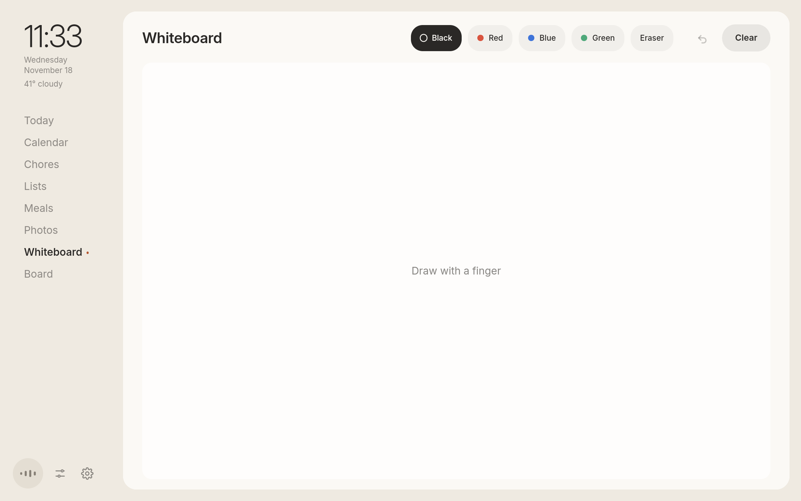

# Customizing OpenHouse from Claude or ChatGPT (the workshop MCP)

Status: first slice built (home network, Claude Code and Claude Desktop; from anywhere through the relay when the
tablet has Use it away from home on: [networking.md](networking.md)). The claude.ai and ChatGPT connectors are
built, not deployed: [web-chat-building.md](web-chat-building.md).

## Why

Editing on the tablet is slow and cramped: a small model budget, a 10" screen, a voice turn that has to end, and a
family waiting while it works. Tonight's "add a whiteboard tab" was confused and got cut short. Someone who wants
to customize the tablet usually already has a better place to do it: Claude Desktop, Claude Code, claude.ai or
ChatGPT on a computer, with a big model, a keyboard and patience.

So the tablet becomes the thing being edited, and the person's own AI app does the editing. The on-tablet
assistant stays for everyday things (lists, timers, the calendar, notes) and small tweaks.

## What the person does

1. On the tablet: Settings (PIN) > **Connect Claude or ChatGPT**. It shows an address and a one-time code, e.g.
   `192.168.1.23:8788  K7QM-2XD9-HPA4`, good for 10 minutes.
2. On the computer, once: add the OpenHouse MCP to Claude Code or Claude Desktop (see "Setting up" below).
3. Tell Claude: "pair with my OpenHouse, 192.168.1.23:8788 K7QM-2XD9-HPA4".
4. The tablet asks: **Let "Sam's MacBook" change the apps and home screen?** Allow / No.
5. From then on: "make a whiteboard tab that looks like Chores". The tablet shows the change being made (the usual
   "working" card, from the computer), the new tab appears, and "undo that" (from the computer or the tablet) takes
   it back.

The computer shows up in Settings, Screens list, where it can be removed (its key stops working at once).

## Design

```
Claude Code / Claude Desktop (the Mac)
  └─ openhouse MCP (stdio, connect/openhouse-mcp.mjs): pairing, then a thin sealed proxy
        │  home network, plain http, every request and reply sealed (ChaCha20-Poly1305, the computer's own key)
        ▼
Tablet: bridge, home-network listener (screens.js, :8788)  ── scope "workshop" ──▶  POST /workshop/mcp
        └─ workshop.js: the MCP server. Its tools are the tablet assistant's own (home-screen.js, chat.js, house.js),
           plus files under apps/, a screenshot, and "done". Edits go through the same lock and undo (edits.js).
```

### The tablet does the work; the computer only carries messages

All tools run on the tablet, in the bridge, behind one route (`/workshop/mcp`). The Mac piece is a few hundred lines
that pairs, seals and forwards; it has no tools of its own except pairing. The same route will serve the cloud
connector later, so there is one MCP server, not two.

### Reusing the paired-screens channel

The tablet already pairs other screens on the Wi-Fi (`bridge/screens.js`, docs in `docs/brain-screens.md`): a
listener that is off until someone adds one, a pairing that someone approves on the tablet, per-device keys,
sealed requests with replay counters, scopes (an allowlist of routes), and revoking. A computer is one more kind of
paired device with one new scope, `workshop`, which allows only `POST /workshop/mcp`. Screens never get it; a
computer gets nothing else.

The difference is the pairing secret. A screen scans a QR code carrying a 32-byte key; a person on a computer has
to type it. So a computer's pairing uses a 12-character code (60 bits, Crockford base32, shown `XXXX-XXXX-XXXX`),
stretched with scrypt into the pairing id and the one-time key. Someone listening on the Wi-Fi who records the
pairing cannot brute-force the code before it expires (10 minutes, scrypt per guess), guessing online ends the
pairing after 5 misses, and nothing happens until someone taps Allow on the tablet, which names the computer.

### Tools

The desktop model gets the tablet assistant's tools, from the same code, so both stay in step:

| From | Tools |
| --- | --- |
| The home screen and board (home-screen.js) | `look_at_notes`, `set_home` (tabs and look), `put_note`, `update_note`, `take_down_note`, `move_on_home`, `set_widget`, `put_back` |
| Changes (chat.js) | `start_editing`, `check_build`, `list_changes`, `undo_change` |
| The household (house.js, chat.js) | `about_household`, lists, chores, meals, calendar events, rewards, routines, preferences |
| New for a computer | `get_guide` (and the same guide as skills, below), `list_files`, `read_file`, `write_file`, `delete_file`, `done_editing`, `look_at_tablet`, `show_on_tablet`, `undo_latest`, `export_plugin` (a plugin folder of some of the family's apps, docs/plugins.md) |

Left out: the voice-only ones (`end_conversation`, `progress`) and the device tools that drive other
Android apps (tapping, installing). `look_at_tablet` is a picture of the screen, so the desktop model sees what it made.

The new ones exist only because the desktop has no turn and no file system on the tablet:

- `start_editing {what}` opens a change, named with what was asked ("A whiteboard tab like Chores"), under the edit
  lock. The tablet shows it as work in progress.
- `write_file`, `delete_file` only inside `apps/` (the same check as the boxed agent's saves: `..` and links
  resolved, never `.git`), and only while this computer's change is open. `apps/home/style.json` is refused (tabs and
  look go through `set_home`).
- `done_editing {summary}` commits the change as one undoable step and lets go of the lock. A change left open goes
  in by itself after 10 quiet minutes, so a closed laptop never blocks the family's assistant.
- `undo_latest` and `undo_change` are the same undo as the tablet's: a git revert, itself undoable.

### Instructions

The MCP `initialize` reply carries short instructions: what OpenHouse is, that a family is watching, and to call
`get_guide` before changing anything. `get_guide` comes in two parts, so moving a tab doesn't mean reading the whole
rulebook: by default the computer's own guide (`bridge/WORKSHOP.md`: how to work, its rules), the home screen as it is
now, how to change it and how notes on Today read (`bridge/NOTES.md`); with `topic: "apps"`, how apps are made and the
quiet kit (`bridge/kit/quiet.css`). Both come from the tablet assistant's own rules (`bridge/AGENT.md`), by section,
leaving out what only applies on the tablet (its reply rules, its other apps and devices, the code layout it sees) and
the Edit tool a computer doesn't have; `start_editing` reminds a computer that hasn't read the apps part yet. The
same texts are also MCP resources (`openhouse://guide/workshop`, `openhouse://guide/apps`, `openhouse://kit/quiet.css`)
for clients that read resources. A tool rather than only resources, because ChatGPT and claude.ai connectors handle
tools well and resources unevenly. `get_guide` also takes `notes`, `plugins` (`bridge/PLUGINS.md`), `design` (how a tab
should look, `bridge/DESIGN.md`; also part of `apps`) and `home` (only the home screen as it is now).

### Skills (MCP's skills extension)

The same guide is also published as skills, which a client loads only when the work calls for one and which change
whenever the tablet updates. Built to the extension's beta spec (`io.modelcontextprotocol/skills`, SEP-2640:
modelcontextprotocol.io/extensions/skills) and Claude Code's "Use skills from MCP servers"
(code.claude.com/docs/en/mcp).

| Skill | What | `get_guide` topic |
| --- | --- | --- |
| `working-here` | How to work from a computer, the rules, changing the home screen (`WORKSHOP.md`, `AGENT.md` sections) | `start` |
| `apps` | How apps are made (`AGENT.md` sections), with `references/quiet.css` and `references/design.md` | `apps` |
| `notes` | How notes on Today read (`NOTES.md`) | `notes` |
| `plugins` | Finding, adding, sharing plugins (`PLUGINS.md`) | `plugins` |
| `design` | How a tab should look (`DESIGN.md`) | `design` |

One source: `bridge/workshop-guide.js` has each topic once, as its skill (`SKILL.md` body and supporting files) and its
`get_guide` text, so the two can't drift. A skill holds only the bridge's own files, never the household's: what is
theirs (the tabs, the look, the apps, which tab is showing) is only in `get_guide` (topic `home`, or `start`), which
the skills point to. So a skill tells a caller nothing `get_guide` doesn't, and both are behind the same door: every
skills request is an MCP request on `/workshop/mcp`, which only a paired computer's `workshop` scope or a connector's
grant reaches (`screens.js`, `web-mcp.js`, the cloud's connector), exactly like the tools.

How it's negotiated. Skills need MCP revision 2026-07-28, which drops `initialize`: each request carries
`params._meta` (`io.modelcontextprotocol/protocolVersion`, `clientCapabilities`) and the client asks `server/discover`.
The workshop serves both eras on one endpoint (`workshop.js` `rpc`): a request with that `_meta` is answered as
2026-07-28 (results with `resultType`, `ttlMs`, `cacheScope`; an unknown version is `-32022` with the versions it
speaks, a missing `clientCapabilities` `-32602`), one without it as before. Only `server/discover` declares the
extension:

```json
{ "capabilities": { "tools": {}, "resources": {}, "extensions": { "io.modelcontextprotocol/skills": {} } } }
```

and its instructions say to load `working-here` and call `get_guide {topic: "home"}` instead of the whole guide.
`skills/list` gives each skill's `skill://<name>/SKILL.md`, its frontmatter and a manifest of every file with its
SHA-256 and size (the client checks what it reads against them); `skills/get` one of them; the files come through
`resources/read`. No `resources/directory/read` (`directoryRead` is left off). Skills are cached `public` for five
minutes (they are the bridge's text); everything else the household's is `private` with a TTL of 0. Reading
`skill://apps/…` counts as having read how apps are made, so `start_editing` doesn't remind it.

The stdio proxy on the computer (`connect/openhouse-mcp.mjs`) answers `server/discover` itself, with the tablet's
capabilities and instructions when it reaches a tablet that has them (an older tablet's `initialize` instructions
otherwise, and no skills), and passes `skills/list`, `skills/get` and `resources/read` on. Unpaired it lists none. The
tablet's own https connector (`web-mcp.js`) also answers a refused 2026-07-28 request with a 400 (an unknown method with
404) and checks `MCP-Protocol-Version` against the request's `_meta`, so an HTTP client can tell the revisions apart;
the cloud's connector passes requests through unchanged.

Who can use them: Claude Code v2.1.331 or later, signed in with a claude.ai plan (not API billing, `claude -p` or a
custom base URL), in a terminal or a local Code session; Claude Desktop's connectors and extensions don't load MCP
skills yet, and ChatGPT only partly. They show as `openhouse:working-here`, `openhouse:apps` and so on. Claude Code
remembers for 7 days that a stdio server didn't speak 2026-07-28; `MCP_PROTOCOL_NEGOTIATION=auto` asks again sooner
(after updating `~/.openhouse/openhouse-mcp.mjs`). Everyone else uses the plugin below, or `get_guide`.

### The OpenHouse plugin (ChatGPT, the Claude apps)

ChatGPT has skills but doesn't load them over MCP, and the Claude apps' connectors don't either, so the same skills
also ship as a plugin that bundles them with the connector. The split:

- **How to work** (the guide: working here, apps, the kit, notes, plugins, design) is skills: over MCP for Claude Code,
  in the plugin for ChatGPT and the Claude apps.
- **The household as it is now** (tabs, apps, people, notes) is tools: `get_guide {topic: "home"}`, `about_household`,
  `look_at_notes`.
- **`get_guide`** with the other topics is the fallback for a client that has the connector alone.

`scripts/build-plugin.mjs` writes it from `bridge/workshop-guide.js` (`--check` says whether what's committed is
current): `connect/plugin/` holds `skills/<name>/` (the same files as `skill://<name>/`), Claude's
`.claude-plugin/plugin.json` and `.mcp.json`, and OpenAI's portable `plugin.json` and `mcp.json`. Both connectors are
the cloud's `https://cloud.openhouse.computer/mcp`, the same address for every household, with OAuth (OpenAI's with
dynamic client registration), so nothing in the plugin is a household's. The repo is the marketplace for both:
`.claude-plugin/marketplace.json` (Claude, and OpenAI's Claude-compatible reading) and `.agents/plugins/marketplace.json`
(ChatGPT and Codex), each listing `./connect/plugin`. Formats from code.claude.com/docs/en/plugins-reference and
/plugin-marketplaces, and developers.openai.com/plugins/build/plugins.

The version. The guide's version is a hash of every skill file (`version()` in `workshop-guide.js`). The plugin's
manifests are `1.0.0+<it>` (Claude pins to that string, so a changed guide is an update), and each `SKILL.md` in it
ends with the version it was made from. The connector says its own in its instructions and in `get_guide {topic:
"home"}`, and tells the model that a copy with another version is old: use `get_guide` for that topic and say once
that the plugin needs updating. (The tablet's guide is the one that's right for it, whichever is newer.)

Installing (from the repo; nothing is published to a directory):
- Claude Code: `/plugin install openhouse --marketplace mrubens/openhouse` (only for the connector: Claude Code
  gets the skills from the connector itself). Tried 2026-11-24 with 2.1.331: `claude plugin validate` passes for the
  plugin and the marketplace, and it installs with its five skills.
- The Claude apps: Customize > Plugins > Add marketplace, `mrubens/openhouse`, with Sync automatically.
- ChatGPT: a workspace admin imports the marketplace (Plugins > Add > Import marketplace, the repository, path
  empty, branch `main` to get updates; ChatGPT checks daily). Not tried yet.
- Codex: `codex plugin marketplace add mrubens/openhouse`. Not tried yet.

### What the family sees

While the computer's change is open, the tab of the app being changed pulses gently in the sidebar (Apps, for a new
app: new apps go there first, and the AI asks at the end whether to put one in the sidebar). Its tab reloads as files
land, and the pulse stops at `done_editing`. No words on the screen. Undo is the same everywhere: "undo" on the tablet takes back the computer's change too.

### Privacy

The family's data (names, lists, calendar) reaches the person's own AI service only after they pair it, which is
their choice of service. Nothing goes anywhere they didn't pick: the tablet talks only to the paired computer, over
the home network.

## Getting it onto the computer: the tablet serves it

No website yet, so the tablet hands it out. While "Connect Claude or ChatGPT" is open (and only then: the same 10
minutes as the code, gone when the screen closes or the code is used), the home-network listener serves one page
(`bridge/connect-page.js`): "Connect Claude or ChatGPT", led by one prompt to copy into any AI that can run commands
(below), then the Claude app's download of `openhouse.mcpb` with the code and three steps (open the file and Install,
say "Connect to my OpenHouse" with the code, tap Allow). The
download button fires once per visit. It serves that page, the two downloads and the kit's font, nothing else. `scripts/runtime-assets.sh` runs
`scripts/build-mcpb.sh`, so the download is built into the runtime with the tablet and always matches it.

The Connect screen leads with **On your computer, open openhouse.local:8788**, the IP and port under it, and a QR
code for the page. What I found getting the address short:
- **The name works.** Android's NsdManager can't advertise a host name (API 35 has no `setHostname`), so the bridge
  answers `openhouse.local` itself with a tiny mDNS responder for one A record, only while the screen is open. Inside
  the tablet's runtime it binds UDP 5353 and joins the multicast group fine (checked on the emulator); the shell holds a
  Wi-Fi multicast lock meanwhile. On this Mac, macOS resolved a name answered by the same code over the real Wi-Fi.
- **Port 80 doesn't.** Binding it from the runtime fails with `EACCES` (Android keeps ports below 1024 for the system),
  so the port stays: `openhouse.local:8788`.
- Two OpenHouses on one network would both claim the name while their Connect screens are open; the IP line covers that.

### The setup prompt (any assistant)

The page's main option ("Connect your AI assistant") is one sentence to paste into Claude Code, Codex, claude.ai,
ChatGPT or another assistant (`setupPrompt` in `bridge/connect-page.js`): add the OpenHouse MCP server at
`https://cloud.openhouse.computer/mcp` (the cloud's web connector, below), sign in with the code shown, tap Allow on the
tablet, then read `https://cloud.openhouse.computer/docs` and work out how best to use it. No local address, so it works
from anywhere. The docs page is the guide for assistants as one Markdown page (openhouse-cloud
`scripts/guide-docs.ts`, made from `bridge/workshop-guide.js` like the skills: nothing of any household). After the
guide changes, run `scripts/cloud.sh node scripts/guide-docs.ts`, commit there and deploy.

What it needs and where it stops:
- The tablet has "Use it away from home" on: the connector reaches it only through the relay. The page says so
  when it's off, and the Claude app's download (below it) still pairs on the Wi-Fi.
- Claude Code and Codex add it themselves and sign in through a localhost redirect, which the connector allows; the
  tablet's Allow names them by the name they registered ("Claude Code on a computer"). claude.ai and ChatGPT can't add
  a connector from a chat: the person adds it in Settings. Cursor's sign-in returns to a `cursor://` address, which
  the connector doesn't allow yet.

The stdio script can also pair through the relay with the code (`openhouse-mcp.mjs pair <code> --name "<who>"`), and
use the tools from a terminal (`tools`, `call <tool> '<json>'`): a computer's welcome (sealed, `bridge/screens.js`)
carries its home address and relay id, so a computer that paired through the cloud reaches the tablet either way.

The page shows the code, so while the Connect screen is open anyone on the home Wi-Fi who opens the page could try
it. The Allow on the tablet, naming the computer, is still the gate.

## Setting up (Claude Code, Claude Desktop)

**Claude Desktop: the OpenHouse extension.** `scripts/build-mcpb.sh` makes `dist/openhouse.mcpb` (about 24 KB, never
committed): `connect/openhouse-mcp.mjs` bundled with only what it imports (the screen client and cipher from
`chat/src`, `bridge/pair-code.js`, `connect/mdns.mjs`), run by Claude Desktop's own Node, so a family needs no
checkout and no Node. Opening the file in Claude Desktop installs it. Not signed or published yet.

**Pairing happens inside Claude.** Unpaired, the extension offers one tool, `pair_with_tablet {code}`, and its
instructions tell the model to ask for the code the tablet shows (the gear, Tablet settings, Connect Claude or
ChatGPT). It finds the tablet on the Wi-Fi by itself: while the code shows, the tablet advertises `_openhouse._tcp`
over Bonjour (Android's NsdManager), and the extension asks every network this computer is on, then tries the code on
each OpenHouse that answers (only the one showing that code knows it). If nothing answers (a Wi-Fi that blocks
multicast, a guest network), it asks for the address shown under the code and pairs with both. The tablet's dialog
also shows the address and code as a QR code.

**Claude Code** (or anything that runs an MCP command), from the same bundle:

```bash
claude mcp add openhouse -- npx openhouse-mcp
```

`connect/package.json` makes `npx openhouse-mcp` work once it's on npm; it is marked private and not published, so
for now use `npx /path/to/openhouse/connect` or `node /path/to/openhouse/connect/openhouse-mcp.mjs`. In a terminal:
`openhouse-mcp pair K7QM-2XD9-HPA4`, `openhouse-mcp status`, `openhouse-mcp forget`.

**Codex** (the CLI and the Codex app share `~/.codex/config.toml`), from the same bundle:

```bash
codex mcp add openhouse -- npx -y openhouse-mcp
```

or in `~/.codex/config.toml`:

```toml
[mcp_servers.openhouse]
command = "npx"
args = ["-y", "openhouse-mcp"]
tool_timeout_sec = 180   # a change can wait up to a minute for the tablet's own assistant to finish
```

Until it's on npm, use `command = "node"` and `args = ["/path/to/openhouse/connect/dist/openhouse-mcp.mjs"]` (after
`scripts/build-mcpb.sh`). Pairing works the same (ask Codex to connect to your OpenHouse, give it the code). Codex
reads an MCP server's tools once, when it starts, so right after pairing it reaches the tablet's tools through
`use_tablet_tool`, which the pairing answer explains; from the next Codex session they're ordinary tools. Pairing
waits at most 100 seconds for Allow (Codex gives a tool 120 by default); if Allow comes later, asking to pair again
finishes it. Checked against Codex's source (its MCP client logs `tools/list_changed` and doesn't reload), not yet
run: the Codex CLI isn't installed on the Mac this was built on.

The pairing is kept in `~/.config/openhouse/pairing.json` (readable only by you).

## Tried on an emulator (2026-11-18)

Claude Code (headless, `claude -p`) with this MCP, against an emulator through `adb forward tcp:18788 tcp:8788`:

1. Settings > Connect Claude or ChatGPT showed the address and code; "Pair with my OpenHouse, 127.0.0.1:18788
   <code>" from Claude Code; the tablet asked "Let “Sam's MacBook Pro” change the apps and home screen?"; Allow.
2. "Add a whiteboard tab that looks like Chores": it read the guide and the Chores app, opened a change, wrote the
   app, added the tab, checked it, looked at the screen, fixed a detail and finished. About 110 seconds, one change.
   The tablet showed it working, then the new tab. Drawing on it works.
3. "Undo that whiteboard tab" from a new Claude Code session: the app and its tab went in one step.



The first try added the tab after finishing, so the app and its tab were two changes, and checking opened the new
app full screen. The tablet now refuses both when a tab was asked for (finish and check say to add the tab first),
rather than trusting the guide to be followed.

The tablet doesn't need its own assistant signed in for any of this: the computer's AI does the work.

Second round (the extension): the `.mcpb` passed `mcpb validate`, unpacked with `mcpb unpack` and its server ran
from outside the repo. Claude Code ran that unpacked server the way Claude Desktop does and paired with the code
alone ("Connect to my OpenHouse. The tablet says 1MCT-ZA9V-ZYP5."), found by Bonjour. The emulator's network can't
carry multicast to the Mac, so a `dns-sd -P` advert on the Mac stood in for the tablet's; whether the tablet's own
advert reaches a Mac on real Wi-Fi is still to be seen on a real tablet. Then "put the Photos tab first" and
"undo that last change" both landed on the emulator. Installing into the real Claude Desktop app was left to a person.

## claude.ai and ChatGPT

Built as the web connector: a remote MCP server with OAuth at `<service>/mcp`, whose sign-in is the tablet's code
and Allow, reaching this same `/workshop/mcp` through the relay. How it works, what changes about trust (the service
holds that connector's key), and the steps on each product: [web-chat-building.md](web-chat-building.md).
